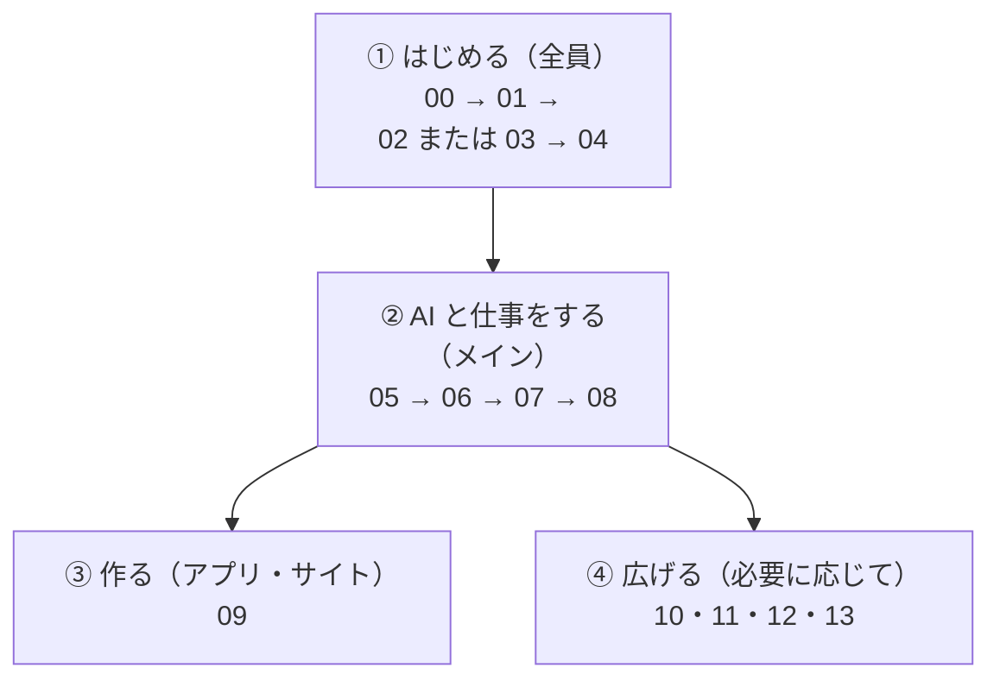

# AI 活用ガイド（AI エージェントと仕事をする）

**プログラミングの知識がなくても、AI エージェントに仕事を手伝ってもらえるようになる**ためのガイドです。パソコンの準備から、毎日の仕事での使い方までをまとめています。

Claude Code・Codex・Antigravity・GitHub Copilot など、特定の AI に依存しない構成です。**好きなものを1つ選んで**進めてください。

## このガイドでできること

| こんな仕事を | AI に頼むと |
|---|---|
| 企画書・提案書をつくる | 質問に答えるだけで、企画書の形にまとめてくれる |
| ブログ記事・SEO 記事を書く | 検索されやすい構成を考えて、下書きまで書いてくれる |
| SNS の投稿を考える | あなたのお店らしい雰囲気で、投稿文を何案も出してくれる |
| メール・お知らせを書く | 相手に合わせた文面の下書きを作ってくれる |
| 調べもの・比較 | 調べて、比べやすい表にまとめてくれる |
| 打ち合わせのメモの整理 | 決まったこと・やることを整理してくれる |
| チラシ・画像の準備 | デザインの依頼書や、画像生成 AI への指示文を作ってくれる |
| Web サイトをつくる | 話しながら、サイトそのものを作ってくれる |

中心になるのは **[AI 仕事部屋](docs/05-ai-workroom.md)** です。AI はふだん会話が終わると内容を忘れてしまいますが、この部屋にあなたのことや仕事の記録・ノウハウを残しておくことで、**使うほどあなたの仕事をわかってくれる相談相手**になります。

## 読む順番

4つの段階に分けています。**① で準備し、② で AI と仕事ができるようになります**。③ と ④ は必要になったときに読めば大丈夫です。



### ① はじめる（全員）

| # | ページ | 内容 |
|---|---|---|
| 00 | [はじめに: ファイル・フォルダ・ターミナルの基本](docs/00-basics.md) | パソコンの基本の言葉（ファイル・フォルダ・パス・GUI と CLI・ターミナル）。知っている人は飛ばしてOK |
| 01 | [AI エージェントの選び方](docs/01-choose-agent.md) | 仕組み・選び方の流れ・比較・それぞれの特徴 |
| 02 | [Mac セットアップ](docs/02-setup-mac.md) | 基本コース（Git・AI エージェント・Orca）→ ステップアップ → 開発者向け |
| 03 | [Windows セットアップ](docs/03-setup-windows.md) | 同上（Windows 版） |
| 04 | [Orca のセットアップ](docs/04-orca.md) | AI エージェントを画面から起動・管理するアプリ |

> 02（Mac）と 03（Windows）は、使う方だけ読めばOKです。セットアップは「基本コース」だけで始められます。

### ② AI と仕事をする（メイン）

| # | ページ | 内容 |
|---|---|---|
| 05 | [**AI 仕事部屋**](docs/05-ai-workroom.md) | AI に仕事を手伝ってもらう部屋。**最初の30分**で、部屋を作って1つ仕事を頼むまで |
| 06 | [使い方レシピ集](docs/06-recipes.md) | 企画書・ブログ・SNS・メール・調べもの・議事録など、そのまま使える頼み方 |
| 07 | [AI への頼み方のコツ](docs/07-how-to-ask.md) | 頼み方の型・直してほしいときの言い方・確認のしかた・保存と取り消し |
| 08 | [AGENTS.md の書き方](docs/08-agents-md.md) | AI が毎回読む指示書。書き方のコツと育て方 |

### ③ 作る（アプリ・サイト）

| # | ページ | 内容 |
|---|---|---|
| 09 | [アプリ・サイトを作る](docs/09-build-projects.md) | プログラムを使うものを作るときのフォルダの管理・雛形・権限の設定 |

### ④ 広げる（必要に応じて）

| # | ページ | 内容 |
|---|---|---|
| 10 | [便利ツールの紹介と使い方](docs/10-tools.md) | エージェントの基本操作・効率化アプリ・タイピング練習・GitHub CLI など |
| 11 | [スキルの取り込みと共有](docs/11-skills.md) | よくやる手順を AI に覚えさせる・人のスキルを取り込む |
| 12 | [複数のエージェントを使う](docs/12-multi-agent.md) | 使い分けのパターン・引き継ぎ・料金と利用枠の管理 |
| 13 | [Obsidian（任意）](docs/13-obsidian-optional.md) | メモアプリ Obsidian と AI の組み合わせ |

> 各ページの上と下に、前後のページと目次へのリンクがあります。
> 図は GitHub 上と Obsidian でそのまま表示されます（Mermaid という書き方で作っています）。

## AI と一緒に読み進める

このリポジトリを手元に置いて（下の「このリポジトリを手元に置く」）Orca に登録すると、**AI がガイド役**になります。`ai-dev-setup` でエージェントを起動して、次のように話しかけてみてください。

```
Mac で基本コースのセットアップを手伝って
```

```
AI 仕事部屋を作って、最初の30分を一緒に進めて
```

```
Orca の使い方を、最初から順番に教えて
```

```
templates の new-project を使って、my-app という名前で新しいプロジェクトを作って
```

AI は `docs/` の内容に沿って、1〜2ステップずつ案内してくれます（ルールは `AGENTS.md` に書いてあります）。

## 最短ルート

1. ファイルやフォルダ、ターミナルに自信がなければ [00](docs/00-basics.md) を読む（10分）
2. [01](docs/01-choose-agent.md) で使う AI エージェントを1つ選ぶ（10分）
3. [02（Mac）](docs/02-setup-mac.md) または [03（Windows）](docs/03-setup-windows.md) の「基本コース」を済ませる（20〜30分）
4. [04](docs/04-orca.md) で Orca を準備し、このガイドを登録する
5. [05 AI 仕事部屋](docs/05-ai-workroom.md) の「最初の30分」で、部屋を作って1つ仕事を頼んでみる
6. あとは [06 レシピ集](docs/06-recipes.md) を見ながら、いろいろな仕事を頼む
7. 作ったものをバックアップ・共有したくなったら、セットアップの「ステップアップ」（GitHub）へ

## このリポジトリを手元に置く（任意）

GitHub 上で読むだけでも進められます。手元に置くと、`templates/` の雛形を使ったり、AI にこのガイドを読ませて質問したりできます。**GitHub アカウントは不要です。**

推奨のディレクトリ構成（[09-build-projects.md](docs/09-build-projects.md)）に合わせて、`orca/projects/` の下に置きます。

Mac（Git を入れたあと）：

```zsh
mkdir -p ~/orca/projects ~/orca/workspaces
cd ~/orca/projects
git clone https://github.com/fujitamasayoshi0402/ai-dev-setup.git
```

Windows（Git for Windows を入れたあと）：

```powershell
mkdir C:\dev\orca\projects, C:\dev\orca\workspaces -Force
cd C:\dev\orca\projects
git clone https://github.com/fujitamasayoshi0402/ai-dev-setup.git
```

> Git をまだ入れていない場合は、GitHub のページ右上の「Code」→「Download ZIP」でダウンロードし、展開したフォルダを `ai-dev-setup` という名前で上の場所に置いても構いません。

### 最新版にする

このガイドは随時更新されます。`ai-dev-setup` でエージェントに「このガイドを最新にして」と頼むと、最新版を取り込みます。自分で行う場合は、**本体のフォルダ**（`orca/projects/ai-dev-setup`）で次を実行します。

```zsh
cd ~/orca/projects/ai-dev-setup
git pull
```

```powershell
cd C:\dev\orca\projects\ai-dev-setup
git pull
```

> Orca で作った作業フォルダ（worktree）は、本体を更新しても古いままです。更新後は、本体か、新しく作った worktree で読み進めてください。
> 雛形からコピーして作ったプロジェクトは、更新しても影響を受けません。ZIP でダウンロードした場合は、新しい ZIP を取り直してください。

## このリポジトリの構成

このリポジトリ自体を、AI と仕事をするためのフォルダ構成のお手本にしています。

```
ai-dev-setup/
├── README.md                 # 目次（このファイル）
├── AGENTS.md                 # AI エージェント共通の指示書
├── CLAUDE.md                 # Claude Code 用（AGENTS.md を読み込むだけ）
├── .agents/skills/           # スキル（Codex・Antigravity・Copilot など）と取り込み元の記録
├── .claude/
│   ├── settings.json         # Claude Code の許可・禁止コマンド（チーム共有）
│   └── skills/               # スキル（Claude Code 用。中身は .agents/skills と同じ）
├── .github/
│   └── pull_request_template.md
├── .gitignore                # 秘密情報・個人設定を除外
├── .gitattributes            # 改行コードを LF に統一
├── .editorconfig             # 文字コード・インデントを統一
├── docs/                     # 本文（番号順に読む）。画面の画像は docs/images/
└── templates/                # 雛形（コピーして使う。ここでは作業しない）
    ├── ai-workroom/          # AI 仕事部屋（AI に仕事を手伝ってもらうとき用）
    ├── new-project/          # アプリ・サイトを作るとき用
    └── obsidian-vault/       # Obsidian でメモを管理するとき用
```

新しく何かを始めるときは、雛形をこのリポジトリの**隣**（`orca/projects/` の下）にコピーして使います。AI に「templates の ai-workroom を使って、my-workroom という名前で AI 仕事部屋を作って」のように頼むのがいちばん簡単です。詳しくは [templates/README.md](templates/README.md) を参照してください。

## 前提

- Mac または Windows のパソコン
- 使いたい AI エージェントのアカウント（どれか1つでOK）
  - 例: Claude（Claude Code）/ ChatGPT（Codex）/ Gemini（Google アカウント）（Antigravity）/ GitHub アカウント（GitHub Copilot）
  - 無料枠の有無や料金プランはエージェントごとに違うので、各公式サイトで確認してください
- GitHub アカウントは**任意**です（バックアップ・共有をしたくなったら作れば十分です）

## 更新について

ツールの進化が速いため、インストールコマンドは変わることがあります。うまくいかない場合は各ツールの公式ドキュメントを確認し、このリポジトリに PR で修正を送ってください。
