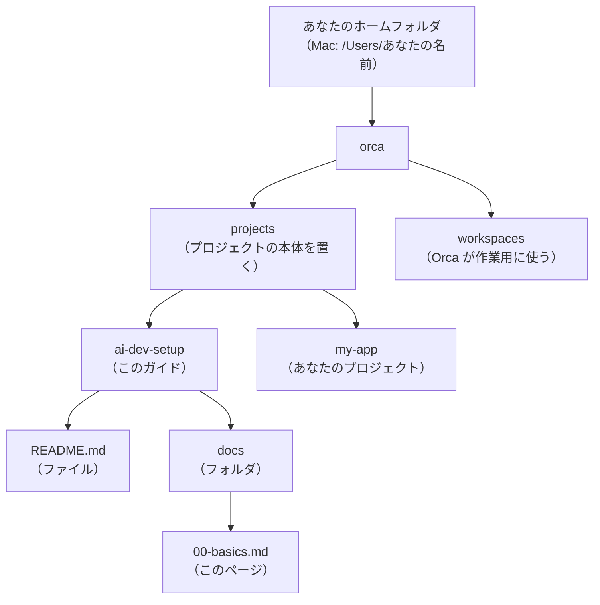

# はじめに: ファイル・フォルダ・ターミナルの基本

AI 駆動開発では、AI に「〇〇フォルダの中の△△ファイルを直して」のように頼んだり、AI から「□□に保存しました」と報告を受けたりします。このページでは、そのやり取りに必要な**パソコンの基本の言葉**を説明します。

知っている人は読み飛ばして、[Mac セットアップ](01-setup-mac.md) または [Windows セットアップ](02-setup-windows.md) へ進んでください。

## ファイルとフォルダ（ディレクトリ）

| 言葉 | たとえると | 例 |
|---|---|---|
| **ファイル** | 1枚の書類 | `README.md`、`写真.png`、`見積書.pdf` |
| **フォルダ** | 書類を入れるファイルボックス。フォルダの中にフォルダも入れられる | `docs`、`orca`、`projects` |
| **ディレクトリ** | フォルダと同じ意味。ターミナルや AI はこちらの言葉をよく使う | — |

フォルダの中にフォルダを入れていくと、木の枝のような形（**階層**）になります。このガイドで使うフォルダの形は次のとおりです。



> **プロジェクト**は、1つの作りもの（アプリ・サイト・資料など）に関係するファイルを、まとめて1つのフォルダに入れたものです。AI に作業を頼むときは、この「プロジェクトのフォルダ」の中で頼みます。

## パス（ファイルの住所）

ファイルやフォルダの場所を、上の階層から順に区切り文字でつないで書いたものを**パス**と呼びます。住所の「東京都 / 新宿区 / 〇〇町」のようなものです。

| | 区切り文字 | 例 |
|---|---|---|
| Mac | `/`（スラッシュ） | `/Users/taro/orca/projects/my-app/README.md` |
| Windows | `\`（バックスラッシュ。日本語キーボードでは `¥` と表示されることもある） | `C:\dev\orca\projects\my-app\README.md` |

- Mac の `~`（チルダ）は「自分のホームフォルダ」の省略です。`~/orca` は `/Users/あなたの名前/orca` と同じ意味です
- AI から「`docs/spec.md` に保存しました」と言われたら、**今のプロジェクトのフォルダの中の、`docs` フォルダの中の `spec.md`** という意味です

## 拡張子（ファイルの種類）

ファイル名の最後の `.` から後ろを**拡張子**と呼び、ファイルの種類を表します。

| 拡張子 | 種類 |
|---|---|
| `.md` | Markdown（マークダウン）。見出しや箇条書きを記号で書く文章ファイル。このガイドも、AI への指示ファイル（`AGENTS.md`）もこの形式 |
| `.txt` | ただの文章 |
| `.png` `.jpg` | 画像 |
| `.json` `.toml` | 設定ファイル（AI やツールが読む） |
| `.sh` `.ps1` | 命令をまとめたファイル（スクリプト） |

拡張子は最初は表示されていないことがあります。見えるようにしておくと便利です。

- **Mac**: Finder のメニュー「Finder」→「設定」→「詳細」→「すべてのファイル名拡張子を表示」をオン
- **Windows**: エクスプローラーの「表示」→「表示」→「ファイル名拡張子」をオン

## 隠しファイル（名前が `.` で始まるもの）

`.gitignore` や `.claude` のように、名前が `.`（ドット）で始まるファイル・フォルダは、**設定用のもの**です。Mac の Finder では、ふだんは表示されません。

- **Mac**: Finder で `⌘ + Shift + .`（コマンド・シフト・ピリオド）を押すと、表示・非表示を切り替えられます
- **Windows**: 多くの場合、そのまま表示されます

> 隠しファイルは、自分で触る必要はほとんどありません。AI が必要に応じて読み書きします。消さないようにだけ注意してください。

## ターミナル（文字でパソコンを操作する画面）

Finder やエクスプローラーはマウスで操作しますが、**ターミナル**は文字（コマンド）を打って操作する画面です。AI エージェントの多くはターミナルの中で動きます。

ターミナルには「**今いるフォルダ**」があります。コマンドや AI は、基本的に今いるフォルダを基準に動きます。

| やりたいこと | Mac | Windows（PowerShell） |
|---|---|---|
| 今いるフォルダを表示 | `pwd` | `pwd` |
| 中身を一覧表示 | `ls` | `ls` |
| 別のフォルダに移動 | `cd フォルダ名` | `cd フォルダ名` |
| 1つ上のフォルダに戻る | `cd ..` | `cd ..` |
| ホームフォルダに戻る | `cd ~` | `cd ~` |
| 今いるフォルダを Finder / エクスプローラーで開く | `open .` | `explorer .` |

試してみましょう。ターミナルを開いて、次の2つを順に実行します。

```zsh
pwd
ls
```

```powershell
pwd
ls
```

1行目で今いるフォルダのパスが、2行目でその中身の一覧が表示されれば OK です。

> **便利な技**: Finder やエクスプローラーからフォルダをターミナルの画面にドラッグ＆ドロップすると、そのフォルダのパスが入力されます。`cd `（cd と半角スペース）を打ってからドロップすれば、そのフォルダに移動できます。

## 困ったら AI に聞く

AI エージェントを入れたあとは、わからない言葉や状況をそのまま聞いて大丈夫です。

```
今いるフォルダの中身を、何のファイルか説明して
```

```
「〇〇」というエラーが出た。どういう意味？
```

```
さっき作ったファイルはどこにある？Finder で開いて
```

次は [Mac セットアップ](01-setup-mac.md) または [Windows セットアップ](02-setup-windows.md) へ進みます。
