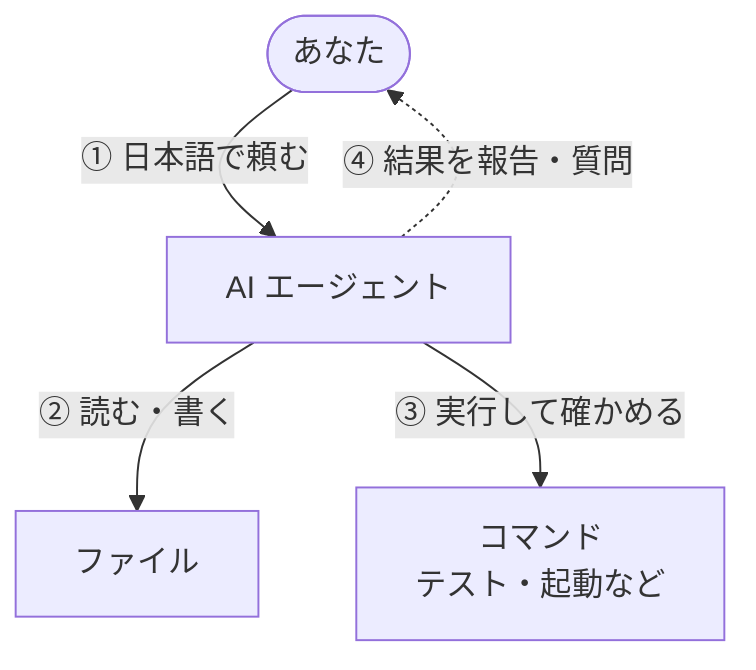
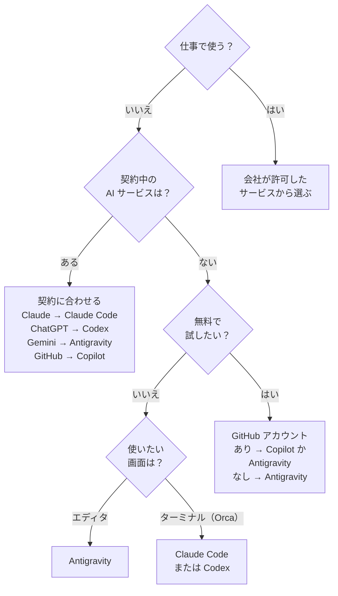

<!-- nav-top -->
[目次](../README.md#読む順番) ＞ ① はじめる ＞ **01 AI エージェントの選び方**
<!-- /nav-top -->

# AI エージェントの選び方

**AI コーディングエージェント**は、ターミナルやエディタの中で動き、ファイルの読み書き・コマンドの実行・Git の操作などを任せられるツールです。基本の使い方はどれもほぼ同じなので、**まずは1つ選んで慣れ、必要になったら他も試す**のがおすすめです。

このページで1つ選んでから、[Mac セットアップ](02-setup-mac.md) または [Windows セットアップ](03-setup-windows.md) でインストールします。

## 仕組み

チャットの AI と違うのは、**あなたのパソコンの中で、ファイルを読み書きしたりコマンドを実行したりできる**ことです。

- 危ない操作（ファイルの削除など）の前には、多くのエージェントが「実行してよいですか？」と確認してきます
- ④の報告を見て、動きを確かめてから次の指示を出す。これをくり返して少しずつ形にしていくのが、基本の進め方です

## 主なエージェント

> 表の「CLI」「GUI」「IDE」などの言葉の意味は、[はじめに: ファイル・フォルダ・ターミナルの基本](00-basics.md#gui-と-cli2つの操作のしかた) で説明しています。

| エージェント | 形態 | 起動 | 指示ファイル |
|---|---|---|---|
| Claude Code（Anthropic） | CLI・エディタ拡張・デスクトップ版 | `claude` | `CLAUDE.md` |
| Codex（OpenAI） | CLI・エディタ拡張 | `codex` | `AGENTS.md` |
| Antigravity（Google の Gemini） | CLI・エディタ（IDE） | `agy` | `AGENTS.md` など |
| GitHub Copilot（GitHub） | CLI・エディタ拡張 | `copilot` | `AGENTS.md` など |

指示ファイル（AI への常設の指示書）については、[AGENTS.md の書き方](06-agents-md.md#エージェントごとに読むファイル)で説明しています。

> この他にも Cursor など、さまざまなツールがあります。Orca などでターミナルから起動できる CLI 型なら、このガイドの手順はほぼそのまま使えます。
>
> **Gemini CLI について**: Google のターミナル向けツール「Gemini CLI」は、2026年6月18日に個人向け（無料・Google AI Pro・Ultra）の受付を終了し、**Antigravity CLI（`agy`）に移行**しました。個人で Gemini を使う場合は Antigravity を選んでください。Gemini CLI は、企業向けのライセンスや API キーを使う場合に限って引き続き使えます（[公式の告知](https://github.com/google-gemini/gemini-cli/discussions/28017)）。

## どのエージェントを選ぶか

どれも「頼むと作ってくれる」という基本は同じです。性能や得意分野はアップデートで頻繁に入れ替わるので、**ランキングよりも、自分の状況に合うかどうか**で選ぶのがおすすめです。

### 選び方の流れ

- **すでに契約しているサービスがあれば、まずそれを使う**のがいちばん無駄がありません（契約しているプランで使えるかは、下の料金ページで確認してください）
- 迷ったときは、インストールが簡単な **Claude Code** か **Antigravity** から始めると、つまずきにくいです
- GitHub アカウントを持っているなら、無料プランのある **GitHub Copilot** から試すのも手です
- 1〜2週間使ってみて、合わなければ別のものに乗り換えれば大丈夫です。このガイドの構成（`AGENTS.md` やスキル）は、どのエージェントでもそのまま使えます

### 比べるときのポイント

| 観点 | Claude Code | Codex | Antigravity | GitHub Copilot |
|---|---|---|---|---|
| 提供元・使うアカウント | Anthropic（Claude） | OpenAI（ChatGPT） | Google（Gemini） | GitHub（このガイドでは GitHub アカウントでログイン） |
| 無料で試せるか | 有料プランが前提 | 無料プランでも一部使える場合あり | 無料プランあり（使える量は少なめ・変わることがある） | 無料プラン（Copilot Free）あり（使える量に上限あり） |
| 主な使い方 | ターミナル中心 | ターミナル中心 | エディタ一体型のアプリ（ターミナル用の CLI もある） | ターミナル（CLI）、または VS Code などのエディタの中 |
| インストール | Mac・Windows とも、コマンド1行 | Mac・Windows とも、公式インストーラーのコマンド1行 | CLI はコマンド1行。エディタ版（IDE）はダウンロードするだけ | Mac はコマンド1行。Windows は PowerShell 7 を入れてから winget |
| Orca で使えるか | 使える | 使える | 使える（CLI 版が必要） | Orca のターミナルで `copilot` を起動して使える（エージェント一覧から選べるかは要確認） |
| 料金・プランの確認先 | [Claude の料金](https://claude.com/pricing) | [Codex の料金](https://developers.openai.com/codex/pricing) | [Antigravity の料金](https://antigravity.google/pricing) | [Copilot のプラン](https://docs.github.com/ja/copilot/get-started/plans) |

> 料金や、どのプランで使えるか・使える量の上限は、よく変わります。契約する前に、必ず各公式の料金ページで確認してください。

### それぞれの特徴

性能の優劣はアップデートで入れ替わるので、ここでは**製品としての特徴**（変わりにくい部分）をまとめます。

| エージェント | 特徴 | 向いている人 |
|---|---|---|
| **Claude Code** | ターミナル中心。スキル・自動処理（Hooks）・サブエージェント・外部連携（MCP）・計画モードなど、**カスタマイズの幅が広い**。エディタ拡張やデスクトップ版もある | 自分好みに作り込みたい人、Orca で並行作業したい人 |
| **Codex** | CLI 版は[オープンソース](https://github.com/openai/codex)。AI が実行できる範囲を制限する**サンドボックスと、実行前の承認の設定**が用意されている。ChatGPT のプランで使え、クラウド上で作業させる使い方もある | ChatGPT を契約している人、安全側の設定で使いたい人 |
| **Antigravity** | Google の AI「**Gemini**」を使う開発ツール。**エディタ一体型のアプリ**で、ファイルを見ながら使える。複数のエージェントの作業をまとめて管理する画面や、[ブラウザを操作して画面を確かめる機能](https://antigravity.google/docs/browser)がある | Gemini を使っている人、ターミナルが苦手な人、画面を見ながら進めたい人、Web サイトを作る人 |
| **GitHub Copilot** | **GitHub との連携が深い**。[Issue を Copilot に割り当てると PR を作ってくれる](https://docs.github.com/ja/copilot/how-tos/use-copilot-agents/cloud-agent/create-a-pr)機能や、[PR のレビュー](https://docs.github.com/ja/copilot/concepts/agents/code-review)がある（使えるプランや条件は公式で確認）。VS Code などのエディタの中でも使える | GitHub をよく使う人、まず無料で試したい人 |

### 選んだあとにつまずきやすい点

| エージェント | つまずきやすい点 | 対処 |
|---|---|---|
| Claude Code | 有料プランが前提。使える量の上限に達すると、しばらく待つ必要がある | 上限のリセット時間を把握しておく。2つ目のエージェントで続ける（[09-multi-agent.md](09-multi-agent.md)） |
| Codex | `CLAUDE.md` は初期設定では読まない | ルールは `AGENTS.md` に書く（このガイドの構成ならそのまま使える） |
| Antigravity | 配布ページに種類が複数ある（CLI・IDE など）。Orca から使うには CLI 版（`agy`）が必要。無料プランの上限は変わりやすい | CLI 版も入れておく。上限は[公式の料金ページ](https://antigravity.google/pricing)で確認 |
| GitHub Copilot | Windows では PowerShell 7 以降が必要。GitHub 上で Issue を任せる機能は、プランや設定によって使えないことがある | PowerShell 7 を入れてから使う。まずはターミナル（CLI 版）やエディタの中で使ってみる |

### 選ぶ前のチェックリスト

- [ ] すでに契約している AI サービスはあるか（Claude / ChatGPT / Gemini / GitHub Copilot）
- [ ] 月にいくらまでなら払えるか（まずは無料・月額 20 ドル前後のプランが目安）
- [ ] エディタで見ながら使いたいか、ターミナルで使いたいか
- [ ] **仕事で使う場合**、会社が許可しているサービスか（社外秘のコードや情報を扱ってよいか）

### 2つ目を選ぶなら

慣れてきて2つ目を契約するなら、**1つ目とは別の提供元**を選ぶと、チェック役として効果的です（作った AI と考え方が違うので、見落としに気づきやすい）。使い分け方は [09-multi-agent.md](09-multi-agent.md) を参照してください。

---

<!-- nav-bottom -->
| ← 前へ: [00 はじめに](00-basics.md) | [目次](../README.md#読む順番) | 次へ: [02 Mac セットアップ](02-setup-mac.md) / [03 Windows セットアップ](03-setup-windows.md) → |
|:---|:---:|---:|
<!-- /nav-bottom -->
