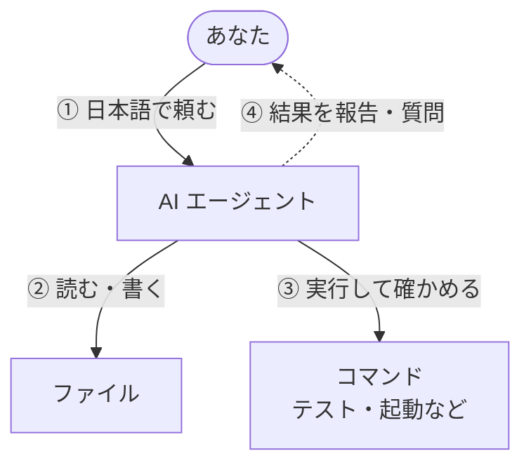
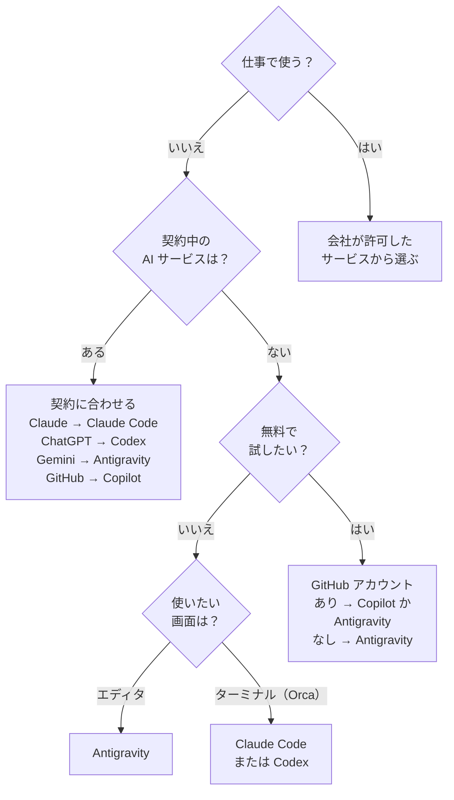
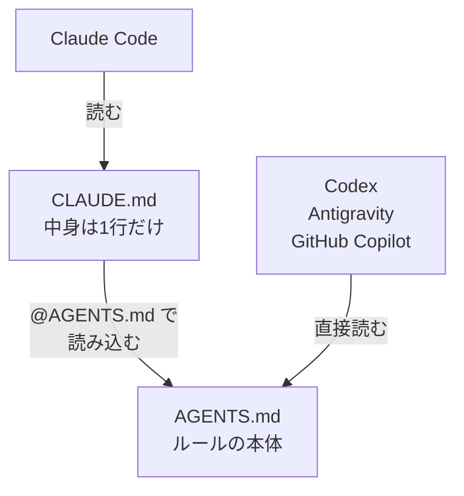
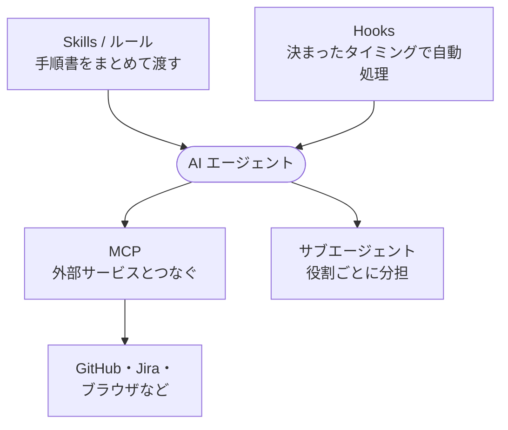
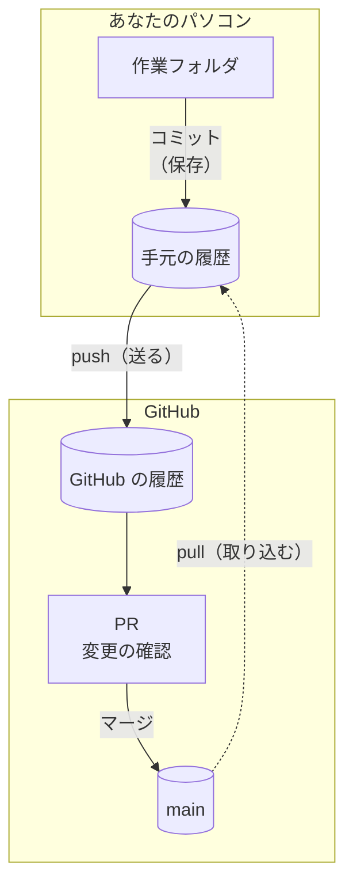
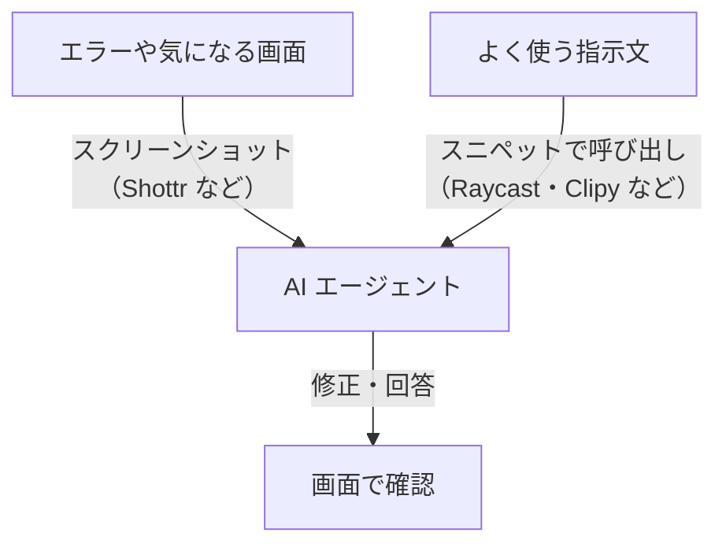

# 便利ツールの紹介と使い方

## AIコーディングエージェント

ターミナルやエディタの中で動き、コードの読み書き・コマンド実行・Git 操作などを任せられるツールです。基本の使い方はどれもほぼ同じなので、**まずは1つに慣れて、必要になったら他も試す**のがおすすめです。

### AIコーディングエージェントの仕組み

チャットの AI と違うのは、**あなたのパソコンの中で、ファイルを読み書きしたりコマンドを実行したりできる**ことです。



- 危ない操作（ファイルの削除など）の前には、多くのエージェントが「実行してよいですか？」と確認してきます
- ④の報告を見て、動きを確かめてから次の指示を出す。これをくり返して少しずつ形にしていくのが、基本の進め方です

### 主なエージェント

> 表の「CLI」「GUI」「IDE」などの言葉の意味は、[はじめに: ファイル・フォルダ・ターミナルの基本](00-basics.md#gui-と-cli2つの操作のしかた) で説明しています。

| エージェント | 形態 | 起動 | 指示ファイル |
|---|---|---|---|
| Claude Code（Anthropic） | CLI・エディタ拡張・デスクトップ版 | `claude` | `CLAUDE.md` |
| Codex（OpenAI） | CLI・エディタ拡張 | `codex` | `AGENTS.md` |
| Antigravity（Google の Gemini） | CLI・エディタ（IDE） | `agy` | `AGENTS.md` など |
| GitHub Copilot（GitHub） | CLI・エディタ拡張 | `copilot` | `AGENTS.md` など |

指示ファイルの詳しい対応は、下の「[指示ファイル](#指示ファイル最重要)」で説明しています。

> この他にも Gemini CLI（Google のターミナル向けツール。Antigravity とは別のもの）、Cursor など、さまざまなツールがあります。Orca などでターミナルから起動できる CLI 型なら、このガイドの手順はほぼそのまま使えます。

### どのエージェントを選ぶか

どれも「頼むと作ってくれる」という基本は同じです。性能や得意分野はアップデートで頻繁に入れ替わるので、**ランキングよりも、自分の状況に合うかどうか**で選ぶのがおすすめです。

#### 選び方の流れ



- **すでに契約しているサービスがあれば、まずそれを使う**のがいちばん無駄がありません（契約しているプランで使えるかは、下の料金ページで確認してください）
- 迷ったときは、インストールが簡単な **Claude Code** か **Antigravity** から始めると、つまずきにくいです
- GitHub アカウントを持っているなら、無料プランのある **GitHub Copilot** から試すのも手です
- 1〜2週間使ってみて、合わなければ別のものに乗り換えれば大丈夫です。このガイドの構成（`AGENTS.md` やスキル）は、どのエージェントでもそのまま使えます

#### 比べるときのポイント

| 観点 | Claude Code | Codex | Antigravity | GitHub Copilot |
|---|---|---|---|---|
| 提供元・使うアカウント | Anthropic（Claude） | OpenAI（ChatGPT） | Google（Gemini） | GitHub（このガイドでは GitHub アカウントでログイン） |
| 無料で試せるか | 有料プランが前提 | 無料プランでも一部使える場合あり | 無料プランあり（使える量は少なめ・変わることがある） | 無料プラン（Copilot Free）あり（使える量に上限あり） |
| 主な使い方 | ターミナル中心 | ターミナル中心 | エディタ一体型のアプリ（ターミナル用の CLI もある） | ターミナル（CLI）、または VS Code などのエディタの中 |
| インストール | Mac・Windows とも、コマンド1行 | Mac・Windows とも、公式インストーラーのコマンド1行 | CLI はコマンド1行。エディタ版（IDE）はダウンロードするだけ | Mac はコマンド1行。Windows は PowerShell 7 を入れてから winget |
| Orca で使えるか | 使える | 使える | 使える（CLI 版が必要） | Orca のターミナルで `copilot` を起動して使える（エージェント一覧から選べるかは要確認） |
| 料金・プランの確認先 | [Claude の料金](https://claude.com/pricing) | [Codex の料金](https://developers.openai.com/codex/pricing) | [Antigravity の料金](https://antigravity.google/pricing) | [Copilot のプラン](https://docs.github.com/ja/copilot/get-started/plans) |

> 料金や、どのプランで使えるか・使える量の上限は、よく変わります。契約する前に、必ず各公式の料金ページで確認してください。

#### それぞれの特徴

性能の優劣はアップデートで入れ替わるので、ここでは**製品としての特徴**（変わりにくい部分）をまとめます。

| エージェント | 特徴 | 向いている人 |
|---|---|---|
| **Claude Code** | ターミナル中心。スキル・自動処理（Hooks）・サブエージェント・外部連携（MCP）・計画モードなど、**カスタマイズの幅が広い**。エディタ拡張やデスクトップ版もある | 自分好みに作り込みたい人、Orca で並行作業したい人 |
| **Codex** | CLI 版は[オープンソース](https://github.com/openai/codex)。AI が実行できる範囲を制限する**サンドボックスと、実行前の承認の設定**が用意されている。ChatGPT のプランで使え、クラウド上で作業させる使い方もある | ChatGPT を契約している人、安全側の設定で使いたい人 |
| **Antigravity** | Google の AI「**Gemini**」を使う開発ツール。**エディタ一体型のアプリ**で、ファイルを見ながら使える。複数のエージェントの作業をまとめて管理する画面や、[ブラウザを操作して画面を確かめる機能](https://antigravity.google/docs/browser)がある | Gemini を使っている人、ターミナルが苦手な人、画面を見ながら進めたい人、Web サイトを作る人 |
| **GitHub Copilot** | **GitHub との連携が深い**。[Issue を Copilot に割り当てると PR を作ってくれる](https://docs.github.com/ja/copilot/how-tos/use-copilot-agents/cloud-agent/create-a-pr)機能や、[PR のレビュー](https://docs.github.com/ja/copilot/concepts/agents/code-review)がある（使えるプランや条件は公式で確認）。VS Code などのエディタの中でも使える | GitHub をよく使う人、まず無料で試したい人 |

#### 選んだあとにつまずきやすい点

| エージェント | つまずきやすい点 | 対処 |
|---|---|---|
| Claude Code | 有料プランが前提。使える量の上限に達すると、しばらく待つ必要がある | 上限のリセット時間を把握しておく。2つ目のエージェントで続ける（[08-multi-agent.md](08-multi-agent.md)） |
| Codex | `CLAUDE.md` は初期設定では読まない | ルールは `AGENTS.md` に書く（このガイドの構成ならそのまま使える） |
| Antigravity | 配布ページに種類が複数ある（CLI・IDE など）。Orca から使うには CLI 版（`agy`）が必要。無料プランの上限は変わりやすい | CLI 版も入れておく。上限は[公式の料金ページ](https://antigravity.google/pricing)で確認 |
| GitHub Copilot | Windows では PowerShell 7 以降が必要。GitHub 上で Issue を任せる機能は、プランや設定によって使えないことがある | PowerShell 7 を入れてから使う。まずはターミナル（CLI 版）やエディタの中で使ってみる |

#### 選ぶ前のチェックリスト

- [ ] すでに契約している AI サービスはあるか（Claude / ChatGPT / Gemini / GitHub Copilot）
- [ ] 月にいくらまでなら払えるか（まずは無料・月額 20 ドル前後のプランが目安）
- [ ] エディタで見ながら使いたいか、ターミナルで使いたいか
- [ ] **仕事で使う場合**、会社が許可しているサービスか（社外秘のコードや情報を扱ってよいか）

#### 2つ目を選ぶなら

慣れてきて2つ目を契約するなら、**1つ目とは別の提供元**を選ぶと、チェック役として効果的です（作った AI と考え方が違うので、見落としに気づきやすい）。使い分け方は [08-multi-agent.md](08-multi-agent.md) を参照してください。

### 共通の基本操作

どのエージェントでも、次の流れは共通です。

作業したいフォルダに移動して、エージェントのコマンド（`claude` / `codex` / `agy` など）を実行すると、対話モードで起動します。

```zsh
cd your-repo
claude
```

| やりたいこと | Claude Code | Codex | Antigravity CLI | GitHub Copilot CLI |
|---|---|---|---|---|
| 対話モードで起動 | `claude` | `codex` | `agy` | `copilot` |
| 1回だけ実行して結果を表示 | `claude -p "..."` | `codex exec "..."` | `agy -p "..."` | `copilot -p "..."` |
| 直前の会話を再開 | `claude -c` | `codex resume --last` | `agy -c` | [公式ドキュメント](https://docs.github.com/ja/copilot/reference/copilot-cli-reference/cli-command-reference)参照 |

起動後によく使う操作（名前は違っても、どのエージェントにもだいたいあります）：

| 操作 | 用途 |
|---|---|
| 計画モード（Plan） | いきなり実装させず、まず計画を出させて確認する |
| 会話のリセット | タスクが変わったら新しい会話にする（古い文脈が残ると精度が落ちる） |
| モデルの切り替え | 速さ重視・賢さ重視で使い分ける |
| 権限（許可）の設定 | よく使う安全なコマンドは確認なしで実行させる |
| 中断 | `Esc` や `Ctrl + C` で途中で止める |
| ファイルの指定 | `@ファイル名` で特定のファイルを読ませる |

詳しい操作は、各エージェントの中で `/help` を実行するか、公式ドキュメントで確認してください。

### 指示ファイル（最重要）

プロジェクトのルートに置くと毎回自動で読み込まれる、「AIへの常設指示書」です。**中身は共通にして、各エージェント用のファイルからは参照するだけ**にすると管理が楽です。



ルールを書き直すのは `AGENTS.md` だけで済み、どのエージェントにも同じルールが伝わります。

書き方のコツや育て方は、[AGENTS.md の書き方](10-agents-md.md) にまとめています。

```markdown
<!-- AGENTS.md（共通の指示書） -->
## 何を作るか
- 地域のパン屋さんを紹介する Web サイト

## 大事にしたいこと
- やさしく、あたたかい雰囲気。スマホで読みやすく

## 進め方のルール
- 私はプログラミングがわからない。専門用語には短い説明を添える
- 終わったら、何を変えたかと確認のしかたを教える
```

```markdown
<!-- CLAUDE.md（Claude Code 用。AGENTS.md を読み込むだけ） -->
@AGENTS.md
```

| 置き場所 | 効く範囲 |
|---|---|
| ホームディレクトリ配下（例: `~/.claude/CLAUDE.md`、`~/.codex/AGENTS.md`、`~/.copilot/copilot-instructions.md`。Antigravity は `~/.gemini/` 配下で、場所はバージョンによって違うため[公式ドキュメント](https://antigravity.google/docs/rules)を参照） | 自分の全プロジェクト（例: 「日本語で回答して」） |
| リポジトリのルート | そのリポジトリ（チームで共有するのでコミットする） |

> どのファイルを自動で読むかは、エージェントによって違います。
>
> | エージェント | 自動で読むファイル | `CLAUDE.md` を読むか |
> |---|---|---|
> | Claude Code | `CLAUDE.md` | ✅ 読む（`AGENTS.md` は直接は読まない） |
> | Codex | `AGENTS.md` | ❌ 初期設定では読まない |
> | Antigravity | `AGENTS.md`、`GEMINI.md`、`.agents/rules/*.md` | ❌ 読まない |
> | GitHub Copilot（CLI） | `AGENTS.md`、`.github/copilot-instructions.md` など | ✅ 読む |
>
> そのため、**ルールの本体は `AGENTS.md` に書き、`CLAUDE.md` には `@AGENTS.md` の1行だけを書く**のがおすすめです。これでどのエージェントも同じルールを読みます。

### 拡張機能（共通の考え方）

エージェントは、次のような仕組みで「できること」を増やせます。



| 機能 | 概要 |
|---|---|
| Skills / ルール | 手順書をまとめて、必要なときにエージェントに読ませる。取り込み・共有の方法は [07-skills.md](07-skills.md) |
| MCP | GitHub・Jira・ブラウザなどの外部サービスとつなぐ共通規格。主要なエージェントのほとんどが対応している |
| Hooks | 「ファイルを編集したら自動で formatter を走らせる」などの自動処理 |
| サブエージェント | 調査・レビューなど、役割ごとに別のエージェントに任せる |

### 複数のエージェントを使い分けるコツ

- **作る AI とチェックする AI を分ける**と、見落としが減ります（例: A が作る → B がレビュー）
- 1つが利用枠の上限に達しても、引き継ぎメモを作れば別のエージェントで続けられます
- [Orca](04-orca.md) を使うと、複数のエージェントを1つの画面で並べて管理できます

詳しくは [08-multi-agent.md](08-multi-agent.md) を参照してください。

## GitHub CLI（gh）— ステップアップ

GitHub を使う場合に入れます。GitHub を使わないなら不要です。

手元のパソコン（ローカル）と GitHub（リモート）の関係は次のとおりです。`gh` があると、AI がこの流れを代わりに操作できます。



| コマンド | 用途 |
|---|---|
| `gh repo create my-app --private --clone` | 非公開のリポジトリを作成して手元に取得 |
| `gh pr create --fill` | PR を作成 |
| `gh pr list` | PR の一覧 |
| `gh pr checkout 12` | 12番の PR を手元に取得 |
| `gh issue list` | Issue の一覧 |
| `gh run watch` | CI（自動チェック）の進捗を見る |

AIエージェントも `gh` を使って PR の作成や CI の確認ができるので、ログインしておくと任せられる範囲が広がります。

## mise — 開発者向け

プロジェクトごとにランタイムのバージョンを固定します。

| コマンド | 用途 |
|---|---|
| `mise use node@22` | このフォルダで Node 22 を使う（`mise.toml` が作られる） |
| `mise install` | `mise.toml` に書かれたバージョンをまとめてインストール |

`mise.toml` をコミットしておけば、メンバー全員（と AI）が同じバージョンで動かせます。

## ripgrep / jq — 開発者向け

| コマンド | 用途 |
|---|---|
| `rg "useState" src/` | `src/` の中から `useState` を高速に検索 |
| `jq '.items[0]' data.json` | JSON ファイルの一部を取り出して見やすく表示 |

## 効率化アプリ

AI に指示を出す・結果を確認する、という往復を速くするためのアプリです。



### Mac

| アプリ | 主な使い方 |
|---|---|
| **Raycast** | `⌘ + Space`（設定で変更）でアプリ起動・ファイル検索。クリップボード履歴、ウィンドウ整列、スニペット（よく使うプロンプトの定型文登録）が便利 |
| **Alfred** | Raycast と同じランチャー系。Powerpack（有料）でワークフローやクリップボード履歴が使える。Raycast とはどちらか1つで十分 |
| **Shottr** | スクリーンショットを撮って、注釈・モザイク・OCR（画像内の文字のコピー）ができる。エラー画面を AI に渡すときに便利 |
| **Clipy** | 無料のクリップボード履歴アプリ。ショートカット（キーは設定で決める）で、過去にコピーした文章を一覧から選んで貼り付けられる。よく使う文章を**スニペット**としてフォルダ分けして登録できる。Raycast や Alfred と一緒に使ってもよい |

おすすめの使い方：

- **よく使うプロンプトをスニペットに登録**しておく（例: `;rv` → 「この変更をレビューして、問題点を箇条書きで」）。Clipy なら「レビュー用」「調べもの用」のようにフォルダ分けしておくと選びやすい
- **AI の回答やエラー文をコピーしておけば、クリップボード履歴（Clipy など）からいつでも貼り直せる**。別のエージェントに同じ指摘を渡すときに便利
- **エラー画面は Shottr で撮って、そのまま AI に貼る**（画像を読めるエージェントが多い）
- **ウィンドウ整列**で「左: エージェント / 右: エディタ」の配置をショートカット1つで作る

### Windows

| アプリ | 主な使い方 |
|---|---|
| **PowerToys** | `Alt + Space` でランチャー、FancyZones でウィンドウ整列、Text Extractor で画面上の文字を認識してコピー |
| Snipping Tool（標準） | `Win + Shift + S` でスクリーンショット |
| クリップボード履歴（標準） | `Win + V` |

## タイピング練習

AI 駆動開発では、**コードを書く量は減っても、AI に指示を書く量は増えます**。速く正確に打てると、指示を丁寧に書けるようになり、結果の質も上がります。

| サイト | 特徴 |
|---|---|
| [寿司打](https://sushida.net/) | 定番の日本語タイピングゲーム。まずは「お手軽 3,000円コース」でクリアを目指す |
| [e-typing](https://www.e-typing.ne.jp/) | 腕試しでスコアとレベルが出るので、上達を記録しやすい |
| [Monkeytype](https://monkeytype.com/) | 英語・数字・記号の練習向け。コマンドやコードの入力に効く |

練習のコツ：

- **ホームポジション**（左手人差し指が `F`、右手人差し指が `J`）を守り、キーボードを見ないで打つ
- 最初は速さより**正確さ**を優先する（ミスが減ると自然に速くなります）
- **記号**（`-` `_` `/` `|` `~` `{}` `[]` `"`）はプログラミングで多用するので重点的に練習する
- 1日10分を毎日続けるのが一番効果があります
- 目安: 寿司打の「お勧め 5,000円コース」で元が取れれば、指示を書くのに困らないレベルです

## その他おすすめ

| ツール | 用途 |
|---|---|
| VS Code / Cursor など | AI が書いた差分の確認・手直し |
| Docker Desktop | DB などのミドルウェアをローカルで動かす |
| 音声入力（OS標準） | 長めの指示や仕様の説明を話して入力する |
