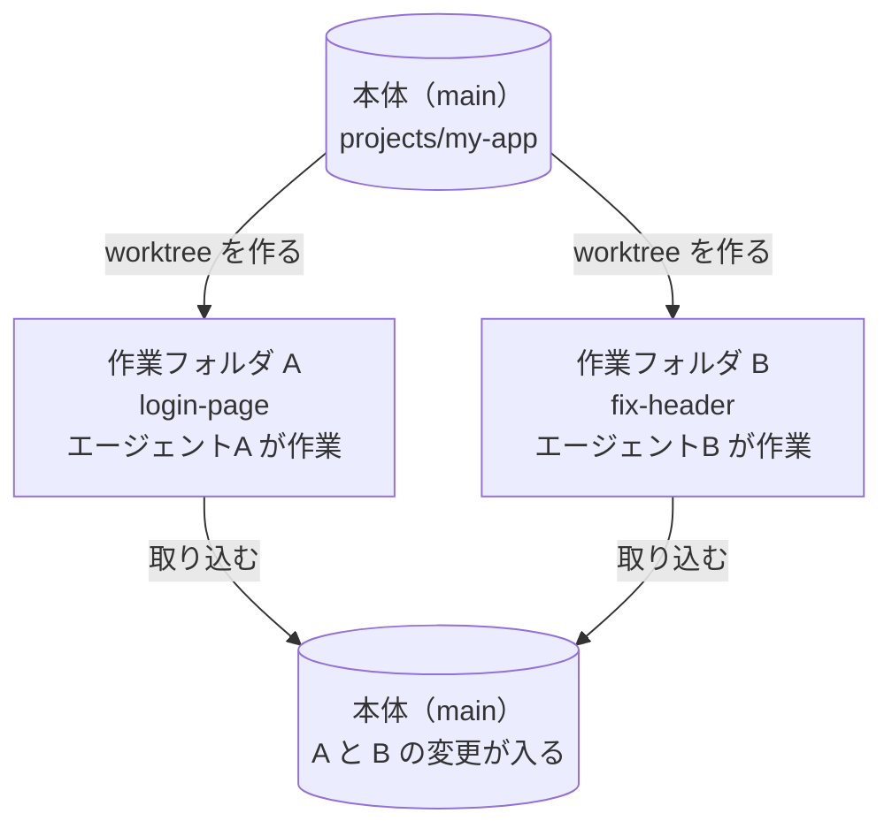
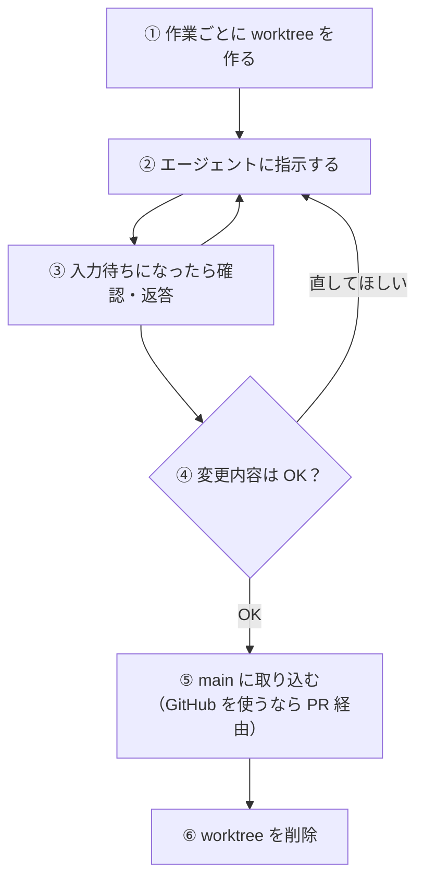

<!-- nav-top -->
[目次](../README.md#読む順番) ＞ ① はじめる ＞ **04 Orca のセットアップ**
<!-- /nav-top -->

# Orca のセットアップ

[Orca](https://github.com/stablyai/orca) は、**AI エージェントを画面から起動・管理する**ためのデスクトップアプリです。フォルダを登録して、ボタンからエージェントを起動できます。

## まず必要なのは2つだけ

このガイドの基本の使い方（[AI 仕事部屋](05-ai-workroom.md)）で必要なのは、次の2つだけです。

1. **インストールと初期設定**（このページの 1・2）
2. **フォルダを登録して、そのフォルダでエージェントを起動する**（このページの 3）

このあと出てくる **worktree**（作業ごとに分身のフォルダを作る機能）は、アプリやサイトづくりで**複数の作業を同時に進める**ときの機能です。AI 仕事部屋や Obsidian の保管庫では使わず、フォルダそのものでエージェントを起動します。最初は読み飛ばしても大丈夫です。

## worktree とは

**worktree（ワークツリー）** は、1つのプロジェクトから作る「作業ごとの分身フォルダ」です。作業ごとにフォルダが分かれるので、AI が同時に別々の作業をしても変更が混ざりません。終わった作業だけを本体（main）に取り込みます。



Orca は、この worktree の作成・エージェントの起動・取り込み・削除を、画面から操作できるようにしたアプリです。

## なぜ Orca を使うのか

| 課題 | Orca での解決 |
|---|---|
| 複数タスクを同時に AI に頼むと変更が混ざる | タスクごとに worktree（別フォルダ・別ブランチ）を自動作成 |
| ターミナルが大量に開いてどれが何かわからない | worktree ごとにタブ・ペインを整理して表示 |
| エージェントの状態（作業中/入力待ち）がわからない | サイドバーで状態を一覧表示・通知 |
| 差分確認や PR 作成が面倒 | アプリ内でファイル差分・Source Control を確認 |

Claude Code・Codex・Antigravity・GitHub Copilot など、ターミナルで動く CLI エージェントなら基本的に何でも使えます。特定のエージェントに縛られないので、複数を並べて使い分けられます。

## 1. インストール

### Mac

```zsh
brew install --cask stablyai/orca/orca
```

または [onOrca.dev/download](https://onorca.dev/download) / [GitHub Releases](https://github.com/stablyai/orca/releases) から DMG（Apple Silicon / Intel）をダウンロード。

### Windows

[GitHub Releases](https://github.com/stablyai/orca/releases) から `.exe` セットアップをダウンロードして実行。

> Windows 向けの修正が RC（リリース候補）版にだけ入っている時期があります。安定版で不具合がある場合は Releases ページで最新の RC を確認してください。

## 2. 初期設定

1. Orca を起動
2. 使うエージェントがインストール済みであることを確認
   ```zsh
   orca agent installed
   ```
   表示された ID（例: `claude` / `codex` / `antigravity`）を、後で `--agent` に指定します。
   `orca` コマンドが使えない場合は、Orca の設定から CLI をインストールしてください。
3. Orca のスキルを各エージェントに入れておくと、エージェント自身が Orca を操作できるようになります
   ```zsh
   orca skills install --all
   ```
4. **作業フォルダ（worktree）の保存先を設定します**。[ディレクトリ構成](09-build-projects.md#1-推奨ディレクトリ構成)に合わせるため、Orca の設定（Settings）で次のようにします
   - ワークスペースの保存先（Workspace directory）: `~/orca/workspaces`（Windows は `C:\dev\orca\workspaces`）
   - プロジェクトごとにフォルダを分ける設定（Nest workspaces）: オン

   これで、worktree が `orca/workspaces/<プロジェクト名>/<作業名>/` に作られます。

   > 設定項目の名前は、Orca のバージョンによって違う場合があります（要確認）。見つからない場合は、Orca の設定画面で「workspace」と検索してください。

## 3. フォルダ（プロジェクト）を登録する

Orca では、作業するフォルダを「プロジェクト」として登録します。**GitHub は不要**で、手元のフォルダをそのまま登録できます。

### 新しく始める場合

1. 作業用フォルダを作ります（例: `~/orca/projects/my-first-app`、Windows は `C:\dev\orca\projects\my-first-app`）
2. Orca のサイドバーの「Add project」から、そのフォルダを選びます
3. Git の管理がまだなら、エージェントに「このフォルダを Git で管理できるようにして（git init して最初のコミットをして）」と頼みます

> Git で管理していないフォルダも登録できますが、その場合は次の「worktree（タスクごとの作業フォルダ）」が使えません。AI の変更を取り消せるようにするためにも、Git での管理をおすすめします。

### GitHub のリポジトリを使う場合

「Add project」でリポジトリの URL を指定してクローンするか、クローン済みのフォルダを選びます。

### CLI で登録する場合

Git で管理しているフォルダを登録する場合：

```zsh
orca repo add --path ~/orca/projects/my-app
```

```powershell
orca repo add --path C:\dev\orca\projects\my-app
```

Git で管理していない普通のフォルダは、最後に `--kind folder` を付けます。登録できたかは `orca repo list` で確認できます。

## 4. worktree を作ってエージェントを起動

GUI ではプロジェクトの「＋」から新しい workspace（worktree）を作成し、エージェントを選びます。

CLI の場合は次のとおりです。`<agent>` には、`orca agent installed` で表示された ID（例: `claude`）を入れます。コマンドは1行なので、Mac・Windows のどちらでもそのまま使えます。

worktree を作成し、そのままエージェントに指示を渡して起動する：

```zsh
orca worktree create --repo name:my-app --name login-page --agent <agent> --prompt "ログイン画面を作って"
```

既存の worktree で、別のエージェントを追加で起動する：

```zsh
orca agent launch --agent <別のagent> --worktree name:login-page --prompt "この変更をレビューして"
```

GitHub を使っている場合は、`--issue 12` を付けると Issue の情報を参照しながら作業できます。

## 5. 基本の作業フロー



①〜③は、別の worktree で並行して進められます。

1. タスクごとに worktree を作る（名前は `feature-xxx` / `fix-xxx` など）
2. エージェントに指示 → 他の worktree で別タスクを並行
3. サイドバーで「入力待ち」になったものから順に確認・返答
4. 差分（変更内容）を確認して、問題なければ取り込む
   - GitHub を使っていない場合: エージェントに「この変更を main に取り込んで（マージして）」と頼む
   - GitHub を使っている場合: PR を作ってレビューしてからマージ（エージェントに「PR を作って」と頼んでもOK）
5. 取り込んだら worktree を削除
   ```zsh
   orca worktree rm --worktree name:feature-a
   ```

## 6. よく使う CLI

| コマンド | 用途 |
|---|---|
| `orca status` | Orca の起動状態確認 |
| `orca worktree list` | worktree 一覧 |
| `orca worktree ps` | 各 worktree の状況サマリー |
| `orca agent list` | 起動中のエージェント一覧 |
| `orca terminal read` | ターミナル出力の読み取り |
| `orca automations create` | 定期実行タスクの作成 |

全コマンドは `orca --help`、エージェント向けのスキーマは `orca agent-context` で確認できます。

## 7. Tips

- **並行数は 2〜3 から**。人間のレビューが追いつく数に抑えるのがコツです
- **セットアップスクリプト**を設定しておくと、worktree 作成時に `npm install` や `.env` のコピーを自動実行できます
- `.env` は worktree に自動でコピーされないことがあるので、上記スクリプトで対応するのがおすすめ
- 実装とレビューを**別のエージェント（別モデル）で相互チェック**すると品質が上がります

---

<!-- nav-bottom -->
| ← 前へ: [02 Mac セットアップ](02-setup-mac.md) / [03 Windows セットアップ](03-setup-windows.md) | [目次](../README.md#読む順番) | 次へ: [05 AI 仕事部屋](05-ai-workroom.md) → |
|:---|:---:|---:|
<!-- /nav-bottom -->
