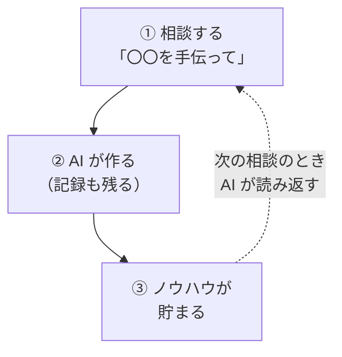
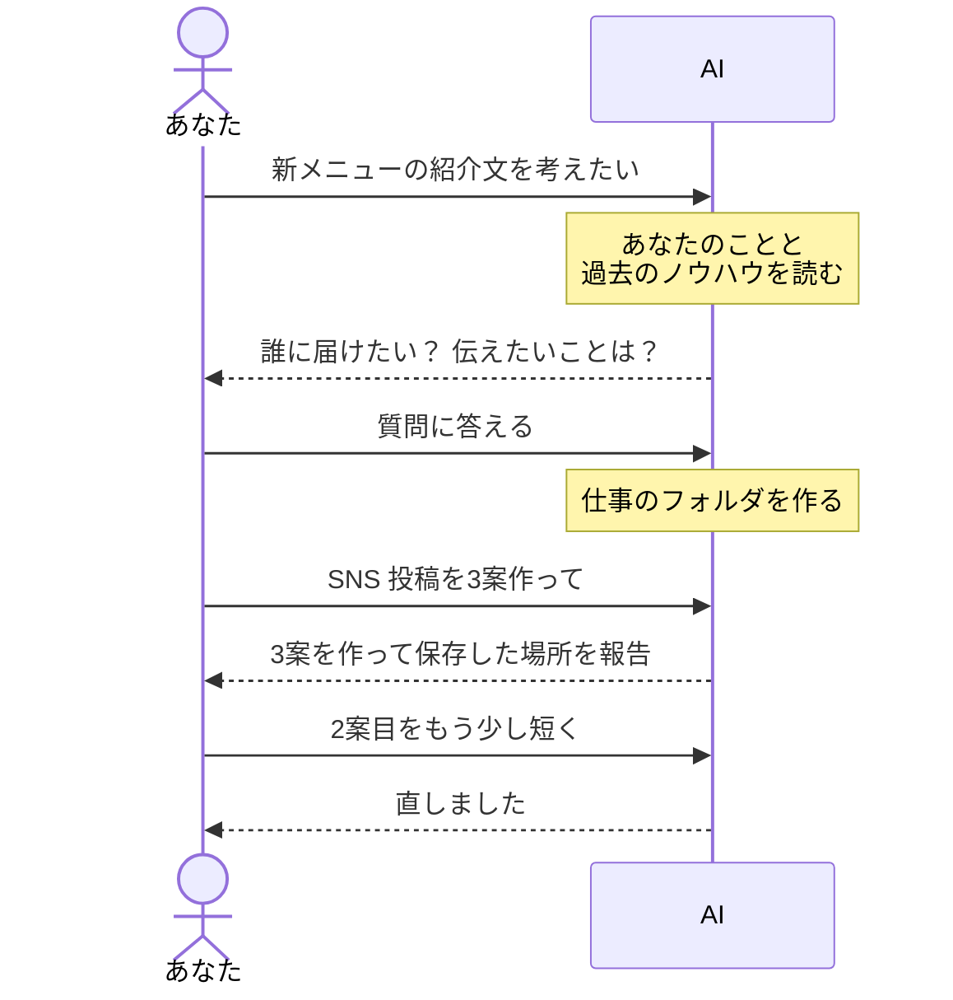

<!-- nav-top -->
[目次](../README.md#読む順番) ＞ ② AI と仕事をする ＞ **05 AI 仕事部屋**
<!-- /nav-top -->

# AI 仕事部屋（AI に仕事を手伝ってもらう）

ここからが本番です。**AI 仕事部屋**は、AI に仕事を手伝ってもらうための専用のフォルダです。プログラミングの知識はいりません。話しかけるだけで使えます。

## どんなことに使えるか

- お店や会社の **企画書・提案書** をつくる
- **ブログ記事**（検索で見つけてもらうための SEO 記事も）を書く
- **SNS の投稿文** を考える
- **メール・お知らせ・案内文** を書く
- **調べもの** をして、比べやすくまとめる
- **打ち合わせのメモ**（議事録）を整理する
- **チラシやバナーのデザイン** の依頼書や、画像生成 AI への指示文をつくる

具体的な頼み方は [使い方レシピ集](06-recipes.md) にまとめています。

## なぜ「部屋」が必要なのか

AI は、**会話が終わると、その内容を忘れてしまいます**。次の日に同じ AI に話しかけても、昨日の相談のことは覚えていません。

AI 仕事部屋では、あなたのこと・仕事の記録・学んだノウハウを**ファイルとして書き残します**。AI は毎回それを読んでから手伝うので、**使うほどあなたのことをわかってくれる相談相手**になっていきます。



## 最初の30分

### 0. 準備

- [① はじめる](../README.md#①-はじめる全員)（00〜04）が終わっていること
- このガイド（`ai-dev-setup`）を手元に置き、Orca に登録していること（[README の「このリポジトリを手元に置く」](../README.md#このリポジトリを手元に置く任意)）

### 1. 部屋をつくる（5分）

Orca で `ai-dev-setup` を開いてエージェントを起動し、次のように頼みます。

```
templates の ai-workroom を使って、my-workroom という名前で AI 仕事部屋を作って
```

AI が `orca/projects/my-workroom` に部屋を作ってくれます。

### 2. 部屋で AI を起動する（5分）

1. Orca の「Add project」で `my-workroom` を登録します
2. **作業フォルダ（worktree）は新しく作らず、`my-workroom` そのもので**エージェントを起動します

> **なぜ worktree を作らないのか**: worktree は本体とは別のフォルダなので、そこで作ったものは本体に取り込むまで見えません。AI 仕事部屋は1つの場所に記録を貯めていく使い方なので、本体でそのまま使うのがわかりやすく安全です。

### 3. あなたのことを教える（10分）

部屋で起動したエージェントに、次のように頼みます。AI が質問してくるので、答えていくだけです。

```
about の profile.md と brand.md を、質問しながら一緒に埋めて
```

| ファイル | 書くこと |
|---|---|
| `about/profile.md` | あなた・お店・会社のこと、お客さんのこと、守ってほしいこと |
| `about/brand.md` | 文章の雰囲気（です・ます調、やわらかい など）、使わない言葉、色 |

ここを埋めておくと、どの仕事も**あなたらしい雰囲気**でそろいます。あとから何度でも直せます。

### 4. 最初の仕事を頼む（10分）

たとえば、SNS の投稿を考えてもらいます。

```
お店のインスタに載せる、新メニューの紹介文を考えたい。相談させて
```



できあがったものは、`work/` の中の仕事のフォルダ（`outputs/`）に保存されます。「保存したファイルを Finder（エクスプローラー）で開いて」と頼めば、場所を開いてくれます。

### 5. ノウハウを残す（1分）

ひと区切りついたら、次のように頼みます。

```
今回わかったことをノウハウに残して
```

AI が「次にも使えること」をまとめて見せてくれるので、よければ OK と答えます。`knowhow/` に保存され、次からの相談で AI が読み返してくれます。

**これで最初の30分は完了です。** あとは、いろいろな仕事を頼んでみてください。

## 部屋の中身

| フォルダ | 何が入るか |
|---|---|
| `about/` | あなた・お店・会社のこと、文章の雰囲気 |
| `inbox/` | 受け取り箱。相談したいこと・資料をとりあえず置く |
| `work/` | 仕事ごとのフォルダ（AI が作る）。頼んだ内容・経過・資料・できあがったもの |
| `knowhow/` | 貯まっていくノウハウ |
| `templates/` | できあがったもののひな形（企画書・SNS 投稿・メールなど10種類） |

フォルダやファイルは AI が作るので、**覚えなくて大丈夫**です。

## よく使う頼み方

| やりたいこと | 頼み方の例 |
|---|---|
| 相談を始める | 「〇〇について相談したい」 |
| 何かを作ってもらう | 「この内容で企画書を作って」「メールの下書きを作って」 |
| 続きをする | 「先週のブログ記事の続きをしたい」 |
| ノウハウを使う | 「SNS について、これまでのノウハウを教えて」 |
| 資料を渡す | 資料を `inbox/` に入れて「inbox の資料を読んで相談したい」 |
| ひな形を増やす | 「チラシの文章のひな形を templates に追加して」 |

> 会話が長くなったり、別の仕事に移ったりするときは、AI が「新しい会話にしましょう（`/clear` など）」「会話を要約しましょう（`/compact` など）」と案内してくれます。続きに必要なことは記録に書き残されるので、新しい会話でも「〇〇の続きをしたい」と言えば続きができます（[くわしく](07-how-to-ask.md#6-会話を整理する新しい会話要約)）。

もっと多くの例は [使い方レシピ集](06-recipes.md) を、頼み方の基本は [AI への頼み方のコツ](07-how-to-ask.md) を参照してください。

## Obsidian で中身を見る（任意）

部屋の中身はすべて普通の文章ファイル（Markdown）なので、メモアプリ [Obsidian](13-obsidian-optional.md) の「フォルダを保管庫として開く」で `my-workroom` を開けば、記録やノウハウを読みやすく見られます。AI と同じフォルダを開くので、書いたものがすぐお互いに見えます。

## 気をつけること

- **送信・投稿・購入は自分で**。AI には下書きまでを頼み、最後のボタンは自分で押します
- **数字や事実は確認する**。AI はまちがえることがあります。外に出す前に、出典（どこで調べたか）を確認します
- **お客さんの情報を扱う場合**、GitHub にバックアップするなら必ず**非公開（Private）**にします
- ノウハウ（`knowhow/`）には、お客さんの名前や個人情報は書きません（AI が一般的な書き方に直してから保存します）
- フォルダ名にもお客さんの名前は入れません（AI が自動で「日時＋ランダムな文字＋テーマ」の名前を付けます）

---

<!-- nav-bottom -->
| ← 前へ: [04 Orca のセットアップ](04-orca.md) | [目次](../README.md#読む順番) | 次へ: [06 使い方レシピ集](06-recipes.md) → |
|:---|:---:|---:|
<!-- /nav-bottom -->
