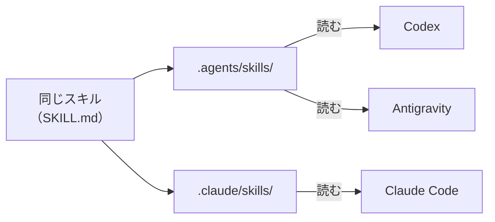
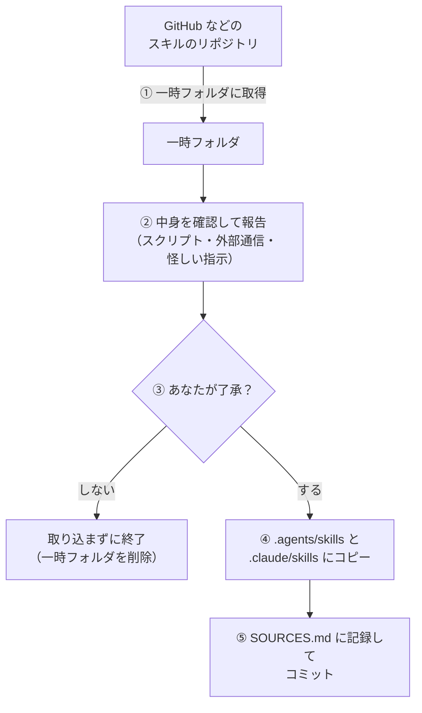

# スキルの取り込みと共有

**スキル**は、AI エージェントに渡す「手順書のセット」です。`SKILL.md` というファイルに「どんなときに使うか」と「何をどの順番でやるか」を書いておくと、AI が必要なときに読んで、その手順どおりに動いてくれます。

スキルは1つのフォルダにまとまっているので、**他の人が GitHub などで公開しているスキルを取り込んだり、自分のスキルを共有したり**できます。

## スキルの置き場所

スキルの形式（`SKILL.md`）はエージェント間で共通ですが、読みにいく場所が違います。このガイドでは、**同じスキルを2か所に置く**ことで、どのエージェントからも使えるようにしています。



| エージェント | プロジェクトのスキル | 自分の全プロジェクト共通のスキル |
|---|---|---|
| Claude Code | `.claude/skills/<スキル名>/` | `~/.claude/skills/<スキル名>/` |
| Codex | `.agents/skills/<スキル名>/` | `~/.agents/skills/<スキル名>/` |
| Antigravity | `.agents/skills/<スキル名>/` | 公式ドキュメント参照（アプリ版と CLI 版で場所が違う） |

```
my-app/
├── .agents/skills/
│   ├── SOURCES.md            # 外部から取り込んだスキルの記録
│   └── <スキル名>/SKILL.md    # Codex・Antigravity などが読む
└── .claude/skills/
    └── <スキル名>/SKILL.md    # Claude Code が読む（中身は同じ）
```

> 名前が `.` で始まるフォルダは、Mac の Finder では表示されません。`⌘ + Shift + .` で表示・非表示を切り替えられます。

雛形（`templates/new-project/`、`templates/obsidian-vault/`）には、このフォルダ構成と `handoff` スキルがあらかじめ入っています。

## このガイドに入っているスキル

| スキル | できること | 頼み方の例 |
|---|---|---|
| `create-from-template` | 雛形から新しいプロジェクトや保管庫を、正しい場所に作る | 「templates の new-project を使って my-app を作って」 |
| `import-skill` | 他のリポジトリのスキルを、安全確認したうえで取り込む | 「https://github.com/owner/repo のスキルを取り込んで」 |
| `handoff` | 別のエージェントに作業を引き継ぐメモを作る・読む（[08-multi-agent.md](08-multi-agent.md#作業を引き継ぐ)） | 「別のエージェントに引き継ぐので、引き継ぎメモを作って」 |

## 他のリポジトリからスキルを取り込む

### 方法1: AI に頼む（おすすめ・Node.js 不要）

Orca で `ai-dev-setup` を開き、エージェントに頼みます。`import-skill` スキルの手順に沿って、AI が次の順で進めます。



1. 取り込み元のリポジトリを一時フォルダに取得し、入っているスキルの一覧を見せる
2. 中身を確認し、スクリプトや外部への通信など**注意が必要な点を報告する**
3. **あなたが了承したら**、`.agents/skills/` と `.claude/skills/` の両方にコピーする
4. 取り込み元を `.agents/skills/SOURCES.md` に記録して、コミットする

```
https://github.com/owner/repo にあるスキルの一覧を見せて
```

```
https://github.com/owner/repo の 〇〇 スキルを、my-app に取り込んで
```

```
my-app の 〇〇 スキルを、取り込み元の最新版に更新して
```

> 取り込み先を指定しなければ、今開いているリポジトリに入ります。別のプロジェクトに入れたいときは、上のようにプロジェクト名を伝えてください。

### 方法2: skills CLI を使う（開発者向け・Node.js が必要）

[skills CLI](https://github.com/vercel-labs/skills) を使うと、取り込みとエージェントごとの配置をまとめて行えます。

| コマンド | 用途 |
|---|---|
| `npx skills add owner/repo --list` | 入っているスキルの一覧を見る |
| `npx skills add owner/repo --skill <スキル名>` | 指定したスキルを取り込む |

インストール先のエージェントは、実行時に選べます。公開されているスキルは [skills.sh](https://skills.sh/) で探せます。

> skills CLI は匿名の利用データを送信します。止めたい場合は、環境変数 `DISABLE_TELEMETRY=1` を設定して実行します。

### Orca のスキル

Orca 自体を AI に操作させるためのスキルは、Orca のコマンドで入れられます（[04-orca.md](04-orca.md)）。

```zsh
orca skills install --all
```

## 安全に使うために

スキルには、AI が実行するスクリプトが入っていることがあります。**知らない人のプログラムをそのまま動かすのと同じ**だと考えてください。

- 信頼できる取り込み元（公式・よく知られた組織・知り合い）から取り込む
- 取り込む前に、AI に「このスキルが何をするか、危ない処理がないか説明して」と確認する
- パスワード・API キー・`.env` に触れるスキルや、外部にデータを送るスキルは特に注意する
- 取り込み元は `SOURCES.md` に残し、あとから更新・削除できるようにしておく

## 自分のスキルを共有する（ステップアップ）

チームや他のプロジェクトで同じスキルを使い回したくなったら、**スキル専用のリポジトリ**を GitHub に作ると便利です。

```
my-skills/                    # GitHub に置くスキル集
├── README.md                 # どんなスキルがあるかの一覧
└── skills/
    ├── weekly-report/
    │   └── SKILL.md
    └── code-review/
        └── SKILL.md
```

- 他のプロジェクトからは、方法1・方法2のどちらでも `my-skills` から取り込めます
- まずは、よく頼む作業を1つスキルにしてみるのがおすすめです。AI に「さっきの手順をスキルにして」と頼めば、`SKILL.md` を書いてくれます

### SKILL.md の書き方

```markdown
---
name: weekly-report
description: 1週間分の日報を読んで、週報を作る。「週報を作って」と頼まれたときに使う。
---

# 週報を作る

1. `10_daily/` から直近7日分の日報を読む
2. 「やったこと」「学んだこと」「来週やること」に分けて、それぞれ3〜5行でまとめる
3. `00_inbox/YYYY-MM-DD-週報.md` として保存する
```

- `description` には「何をするか」と「どんなときに使うか」を書く。AI はこれを見て、いつ使うかを判断します
- 本文は、人に頼むときと同じように手順を番号つきで書く
