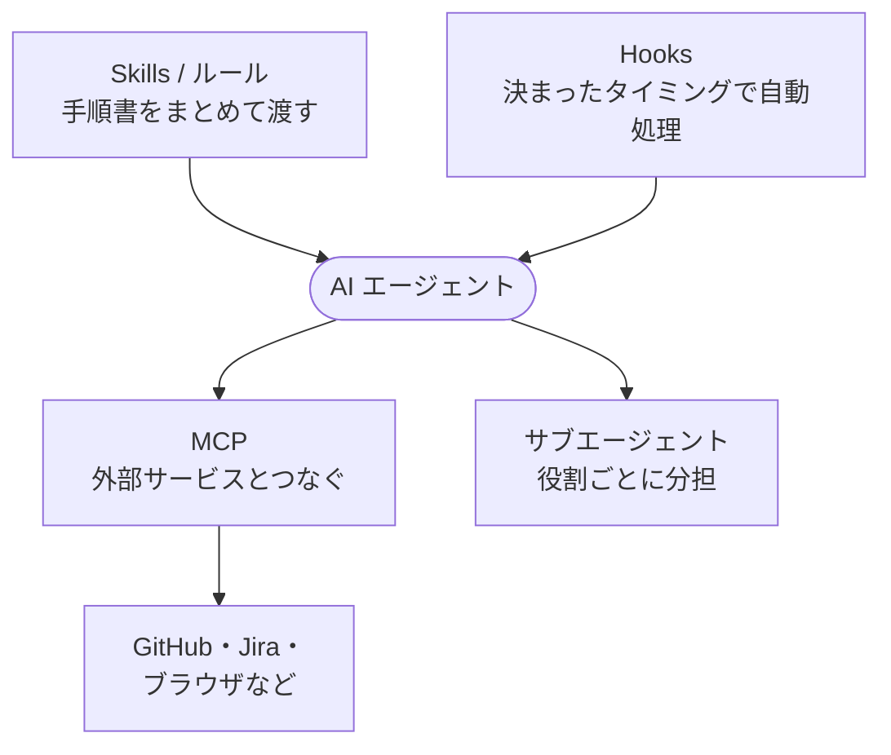
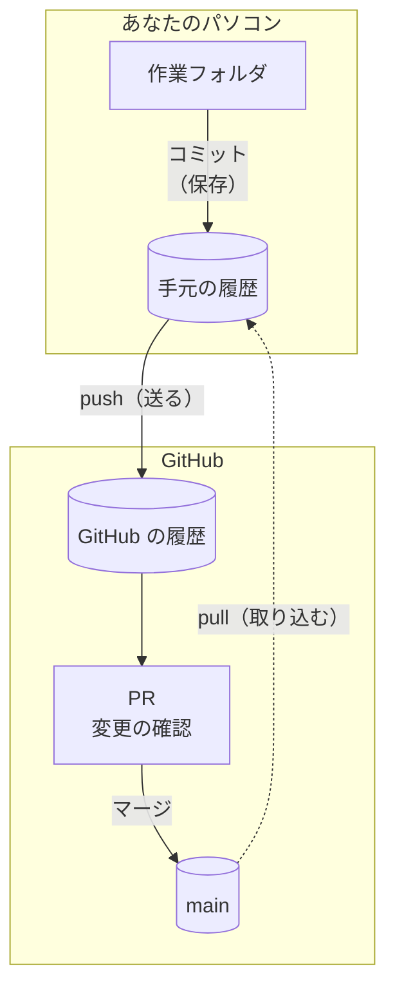
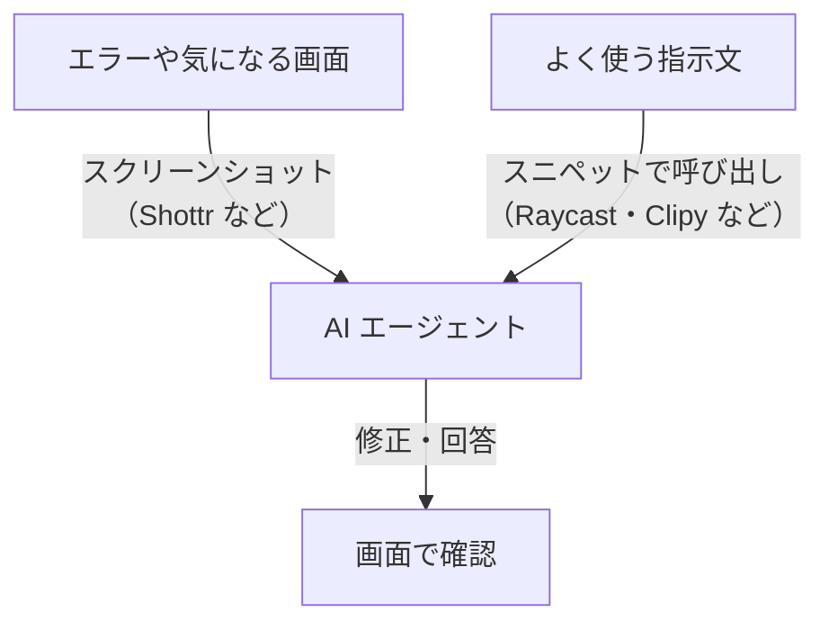

<!-- nav-top -->
[目次](../README.md#読む順番) ＞ ② 使いこなす ＞ **07 便利ツール**
<!-- /nav-top -->

# 便利ツールの紹介と使い方

AI エージェントの基本操作と、作業を楽にするツール・アプリ、タイピング練習を紹介します。エージェントの選び方は [01-choose-agent.md](01-choose-agent.md) を参照してください。

## AI エージェントの基本操作

どのエージェントでも、次の流れは共通です。

作業したいフォルダに移動して、エージェントのコマンド（`claude` / `codex` / `agy` など）を実行すると、対話モードで起動します。

```zsh
cd your-repo
claude
```

| やりたいこと | Claude Code | Codex | Antigravity CLI | GitHub Copilot CLI |
|---|---|---|---|---|
| 対話モードで起動 | `claude` | `codex` | `agy` | `copilot` |
| 1回だけ実行して結果を表示 | `claude -p "..."` | `codex exec "..."` | `agy -p "..."` | `copilot -p "..."` |
| 直前の会話を再開 | `claude -c` | `codex resume --last` | `agy -c` | [公式ドキュメント](https://docs.github.com/ja/copilot/reference/copilot-cli-reference/cli-command-reference)参照 |

起動後によく使う操作（名前は違っても、どのエージェントにもだいたいあります）：

| 操作 | 用途 |
|---|---|
| 計画モード（Plan） | いきなり実装させず、まず計画を出させて確認する |
| 会話のリセット | タスクが変わったら新しい会話にする（古い文脈が残ると精度が落ちる） |
| モデルの切り替え | 速さ重視・賢さ重視で使い分ける |
| 権限（許可）の設定 | よく使う安全なコマンドは確認なしで実行させる |
| 中断 | `Esc` や `Ctrl + C` で途中で止める |
| ファイルの指定 | `@ファイル名` で特定のファイルを読ませる |

詳しい操作は、各エージェントの中で `/help` を実行するか、公式ドキュメントで確認してください。

## 拡張機能（共通の考え方）

エージェントは、次のような仕組みで「できること」を増やせます。



| 機能 | 概要 |
|---|---|
| Skills / ルール | 手順書をまとめて、必要なときにエージェントに読ませる。取り込み・共有の方法は [08-skills.md](08-skills.md) |
| MCP | GitHub・Jira・ブラウザなどの外部サービスとつなぐ共通規格。主要なエージェントのほとんどが対応している |
| Hooks | 「ファイルを編集したら自動で formatter を走らせる」などの自動処理 |
| サブエージェント | 調査・レビューなど、役割ごとに別のエージェントに任せる |

## 複数のエージェントを使い分けるコツ

- **作る AI とチェックする AI を分ける**と、見落としが減ります（例: A が作る → B がレビュー）
- 1つが利用枠の上限に達しても、引き継ぎメモを作れば別のエージェントで続けられます
- [Orca](04-orca.md) を使うと、複数のエージェントを1つの画面で並べて管理できます

詳しくは [09-multi-agent.md](09-multi-agent.md) を参照してください。

## GitHub CLI（gh）— ステップアップ

GitHub を使う場合に入れます。GitHub を使わないなら不要です。

手元のパソコン（ローカル）と GitHub（リモート）の関係は次のとおりです。`gh` があると、AI がこの流れを代わりに操作できます。



| コマンド | 用途 |
|---|---|
| `gh repo create my-app --private --clone` | 非公開のリポジトリを作成して手元に取得 |
| `gh pr create --fill` | PR を作成 |
| `gh pr list` | PR の一覧 |
| `gh pr checkout 12` | 12番の PR を手元に取得 |
| `gh issue list` | Issue の一覧 |
| `gh run watch` | CI（自動チェック）の進捗を見る |

AIエージェントも `gh` を使って PR の作成や CI の確認ができるので、ログインしておくと任せられる範囲が広がります。

## mise — 開発者向け

プロジェクトごとにランタイムのバージョンを固定します。

| コマンド | 用途 |
|---|---|
| `mise use node@22` | このフォルダで Node 22 を使う（`mise.toml` が作られる） |
| `mise install` | `mise.toml` に書かれたバージョンをまとめてインストール |

`mise.toml` をコミットしておけば、メンバー全員（と AI）が同じバージョンで動かせます。

## ripgrep / jq — 開発者向け

| コマンド | 用途 |
|---|---|
| `rg "useState" src/` | `src/` の中から `useState` を高速に検索 |
| `jq '.items[0]' data.json` | JSON ファイルの一部を取り出して見やすく表示 |

## 効率化アプリ

AI に指示を出す・結果を確認する、という往復を速くするためのアプリです。



### Mac

| アプリ | 主な使い方 |
|---|---|
| **Raycast** | `⌘ + Space`（設定で変更）でアプリ起動・ファイル検索。クリップボード履歴、ウィンドウ整列、スニペット（よく使うプロンプトの定型文登録）が便利 |
| **Alfred** | Raycast と同じランチャー系。Powerpack（有料）でワークフローやクリップボード履歴が使える。Raycast とはどちらか1つで十分 |
| **Shottr** | スクリーンショットを撮って、注釈・モザイク・OCR（画像内の文字のコピー）ができる。エラー画面を AI に渡すときに便利 |
| **Clipy** | 無料のクリップボード履歴アプリ。ショートカット（キーは設定で決める）で、過去にコピーした文章を一覧から選んで貼り付けられる。よく使う文章を**スニペット**としてフォルダ分けして登録できる。Raycast や Alfred と一緒に使ってもよい |

おすすめの使い方：

- **よく使うプロンプトをスニペットに登録**しておく（例: `;rv` → 「この変更をレビューして、問題点を箇条書きで」）。Clipy なら「レビュー用」「調べもの用」のようにフォルダ分けしておくと選びやすい
- **AI の回答やエラー文をコピーしておけば、クリップボード履歴（Clipy など）からいつでも貼り直せる**。別のエージェントに同じ指摘を渡すときに便利
- **パスワードや API キーをコピーしたあとは、クリップボード履歴から消す**。履歴に残ったままだと、うっかり AI に貼り付けてしまうことがある（Clipy・Raycast・Windows の `Win + V` のどれでも同じ）
- **エラー画面は Shottr で撮って、そのまま AI に貼る**（画像を読めるエージェントが多い）
- **ウィンドウ整列**で「左: エージェント / 右: エディタ」の配置をショートカット1つで作る

### Windows

| アプリ | 主な使い方 |
|---|---|
| **PowerToys** | `Alt + Space` でランチャー、FancyZones でウィンドウ整列、Text Extractor で画面上の文字を認識してコピー |
| Snipping Tool（標準） | `Win + Shift + S` でスクリーンショット |
| クリップボード履歴（標準） | `Win + V` |

## タイピング練習

AI 駆動開発では、**コードを書く量は減っても、AI に指示を書く量は増えます**。速く正確に打てると、指示を丁寧に書けるようになり、結果の質も上がります。

| サイト | 特徴 |
|---|---|
| [寿司打](https://sushida.net/) | 定番の日本語タイピングゲーム。まずは「お手軽 3,000円コース」でクリアを目指す |
| [e-typing](https://www.e-typing.ne.jp/) | 腕試しでスコアとレベルが出るので、上達を記録しやすい |
| [Monkeytype](https://monkeytype.com/) | 英語・数字・記号の練習向け。コマンドやコードの入力に効く |

練習のコツ：

- **ホームポジション**（左手人差し指が `F`、右手人差し指が `J`）を守り、キーボードを見ないで打つ
- 最初は速さより**正確さ**を優先する（ミスが減ると自然に速くなります）
- **記号**（`-` `_` `/` `|` `~` `{}` `[]` `"`）はプログラミングで多用するので重点的に練習する
- 1日10分を毎日続けるのが一番効果があります
- 目安: 寿司打の「お勧め 5,000円コース」で元が取れれば、指示を書くのに困らないレベルです

## その他おすすめ

| ツール | 用途 |
|---|---|
| VS Code / Cursor など | AI が書いた差分の確認・手直し |
| Docker Desktop | DB などのミドルウェアをローカルで動かす |
| 音声入力（OS標準） | 長めの指示や仕様の説明を話して入力する |

---

<!-- nav-bottom -->
| ← 前へ: [06 AGENTS.md の書き方](06-agents-md.md) | [目次](../README.md#読む順番) | 次へ: [08 スキルの取り込みと共有](08-skills.md) → |
|:---|:---:|---:|
<!-- /nav-bottom -->
