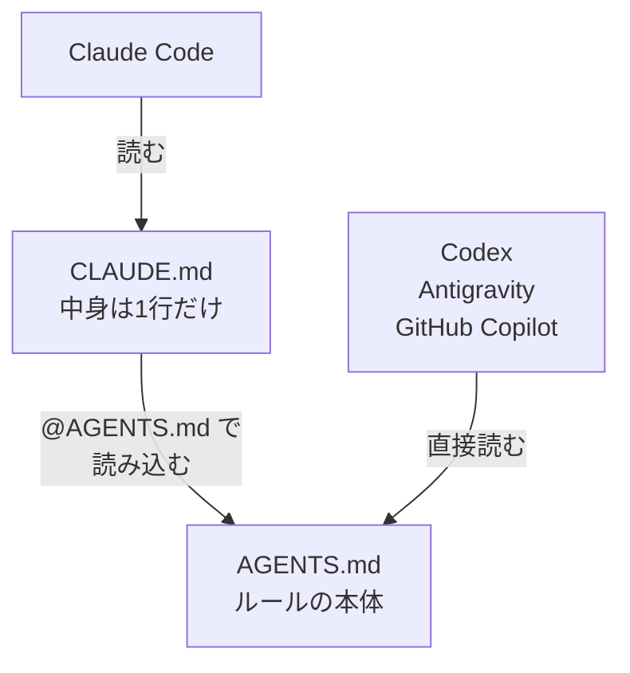
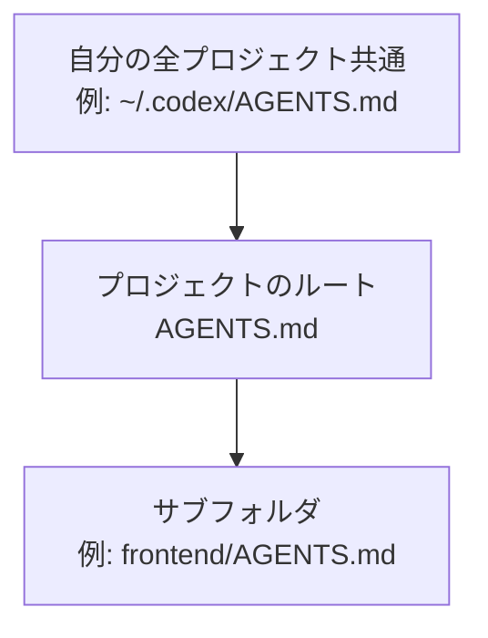
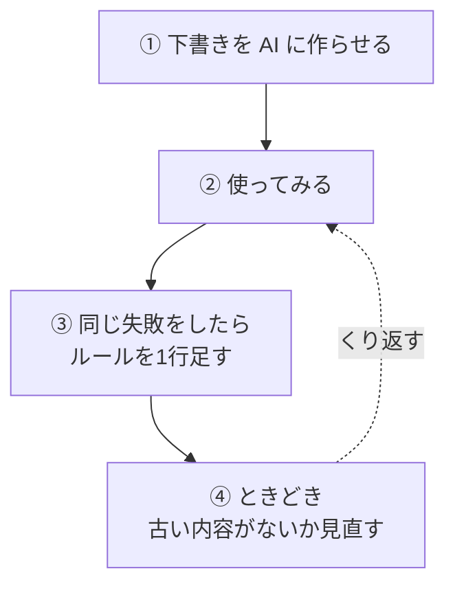

<!-- nav-top -->
[目次](../README.md#読む順番) ＞ ② AI と仕事をする ＞ **08 AGENTS.md の書き方**
<!-- /nav-top -->

# AGENTS.md の書き方（ベストプラクティスと Tips）

`AGENTS.md` は、AI エージェントが作業を始めるたびに自動で読む**「常設の指示書」**です。ここに何をどう書くかで、AI の仕事ぶりが大きく変わります。

> `AGENTS.md` は、多くのエージェントが読める共通の形式です（[agents.md](https://agents.md/)）。Claude Code 用の `CLAUDE.md` には `@AGENTS.md` の1行だけを書いて、中身を共通にするのがこのガイドのやり方です（[下で説明](#エージェントごとに読むファイル)）。

## README.md との違い

| | README.md | AGENTS.md |
|---|---|---|
| 読む人 | 人間 | AI エージェント |
| 書くこと | プロジェクトの紹介、使い方 | AI が作業するための**具体的な指示**（作りたいもの・進め方のルール・してほしくないこと） |
| たとえると | パンフレット | 新しく入った人への**引き継ぎ書** |

「初日の新人に、口頭で伝えておきたいこと」を書くイメージです。

## エージェントごとに読むファイル

プロジェクトのルート（いちばん上のフォルダ）に置くと、毎回自動で読み込まれます。ただし、**どのファイルを読むかはエージェントによって違います**。

| エージェント | 自動で読むファイル | `CLAUDE.md` を読むか |
|---|---|---|
| Claude Code | `CLAUDE.md` | ✅ 読む（`AGENTS.md` は直接は読まない） |
| Codex | `AGENTS.md` | ❌ 初期設定では読まない |
| Antigravity | `AGENTS.md`、`GEMINI.md`、`.agents/rules/*.md` | ❌ 読まない |
| GitHub Copilot（CLI） | `AGENTS.md`、`.github/copilot-instructions.md` など | ✅ 読む |

そこで、**ルールの本体は `AGENTS.md` に書き、`CLAUDE.md` には `@AGENTS.md` の1行だけを書きます**。これで、どのエージェントも同じルールを読みます。



```markdown
<!-- CLAUDE.md（Claude Code 用。AGENTS.md を読み込むだけ） -->
@AGENTS.md
```

ルールを書き直すのは `AGENTS.md` だけで済みます。このガイドの雛形には、この2つのファイルが最初から入っています。

## 書くとよいこと（チェックリスト）

**あなたが書くこと**（ふだんの言葉で大丈夫です）

- [ ] **何を作るか**: 1〜3行で
- [ ] **誰のためか**: 使う人・読む人
- [ ] **大事にしたいこと**: 雰囲気・色・言葉づかいなど
- [ ] **進め方のルール**: 「専門用語は説明して」「始める前に何をするか説明して」など、AI にしてほしいふるまい
- [ ] **完了の条件**: どうなったら終わりか（例: スマホで表示が崩れていない）
- [ ] **やってはいけないこと・先に聞いてほしいこと**: 触ってほしくない文章、勝手に追加してほしくないもの
- [ ] **用語**: そのプロジェクト特有の言葉の意味
- [ ] **会話の整理の案内**: 話題が変わったら新しい会話（`/clear` など）、長くなったら要約（`/compact` など）を AI から案内してもらう（雛形には最初から入っています）

**AI に書いてもらうこと**（技術的なこと）

- [ ] **フォルダの構成**: 主なフォルダと、それぞれの役割
- [ ] **技術メモ**: 使っている技術、起動や確認のしかた（コマンド）
- [ ] **Git の運用**: ブランチやコミットの決まり

全部埋める必要はありません。最初は「何を作るか」「大事にしたいこと」「進め方のルール」の3つで十分です。技術的なことは、作り始めてから AI に「AGENTS.md に書いておいて」と頼めば追記してくれます。

## 書き方のコツ

### 1. 具体的に書く

| ❌ あいまい | ✅ 具体的 |
|---|---|
| おしゃれなデザインにする | 余白を広めにとる。使う色は茶色・クリーム色・白の3色まで |
| ちゃんと確認する | 作業が終わったら、スマホとパソコンの画面で表示が崩れていないか確認し、結果を報告する |
| わかりやすい文章で | です・ます調。専門用語には短い説明を添える |

### 2. 理由を一言添える

理由があると、AI が書かれていない場面でも応用できます。

```markdown
- 「お知らせ」のページは編集しない（店長が毎週、手作業で更新しているため）
```

### 3. 「しない」だけでなく「代わりにどうするか」も書く

```markdown
- 写真は勝手に差し替えない。合う写真がなければ、どんな写真が必要かを教えてくれれば私が用意する
```

### 4. 箇条書き・短い文で書く

長い文章より、1行1ルールの箇条書きのほうが確実に守られます。

### 5. 大事なことを上に、強調は控えめに

すべてに「重要」「必ず」を付けると、どれが本当に大事かわからなくなります。強調は本当に守ってほしい数個だけにします。

### 6. 長くしすぎない

`AGENTS.md` は毎回読み込まれるので、長いほど AI の「作業用の記憶」を圧迫します。エージェントによっては読む量に上限もあります（例: Codex は初期設定で 32KiB まで）。

- 目安は**1〜2画面（100〜200行程度）**。これを超えそうなら分けます
- 詳しい手順は [スキル](11-skills.md) や `docs/` に書き、`AGENTS.md` からは場所だけ示します（必要なときだけ読ませる）

```markdown
- サイトを公開するときは、docs/公開のしかた.md を読んでから行う
```

### 7. 実在するものだけを書く

もう使っていないフォルダや、古いやり方が書いてあると、AI はそれを信じて失敗します。作り方を変えたら、AI に「AGENTS.md も直しておいて」と頼みます。

### 8. 秘密情報は書かない

`AGENTS.md` は Git で共有されます。パスワードや API キーは書かず、「`.env` の `〇〇` を使う」のように**場所だけ**書きます。

## 置き場所と読まれ方



| 置き場所 | 書くこと | 例 |
|---|---|---|
| 自分の全プロジェクト共通（ホームフォルダの下。例: `~/.claude/CLAUDE.md`、`~/.codex/AGENTS.md`、`~/.copilot/copilot-instructions.md`。Antigravity は [公式ドキュメント](https://antigravity.google/docs/rules) 参照） | 自分の好み | 「日本語で答えて」「結論から短く」 |
| プロジェクトのルート | プロジェクト全体のルール | 作りたいもの・進め方のルール・技術メモ |
| サブフォルダ（必要なときだけ） | その部分だけのルール | `frontend/` だけの書き方の決まり |

- Codex や Antigravity は、作業しているフォルダから上の階層へたどって `AGENTS.md` を読みます。サブフォルダに置いた `AGENTS.md` は、その中で作業するときに効きます
- Claude Code は、サブフォルダの `CLAUDE.md` を、そのフォルダのファイルを扱うときに読みます。サブフォルダに `AGENTS.md` を置くときは、**隣に `@AGENTS.md` の1行だけの `CLAUDE.md` も置きます**（ルートと同じやり方です）
- まずはルートの1つだけで十分です。大きくなってきたら分けます

## 育て方

`AGENTS.md` は、最初から完璧に書くものではなく、**使いながら育てる**ものです。



### ① 下書きを AI に作らせる

これから作り始めるなら、質問に答えるだけで下書きができます。

```
何を作りたいか質問しながら、AGENTS.md の〇〇を一緒に埋めて
```

すでにファイルがあるプロジェクトなら、AI に調べてもらいます（Claude Code と Codex には、このための `/init` コマンドもあります）。

```
このプロジェクトを調べて、AGENTS.md の下書きを作って
```

### ② 使ってみる

ふだんどおり AI に頼みます。「何度も同じことを言っている」「思っていたのと違う」と感じたところをメモしておくと、次の③で役立ちます。

### ③ 同じ失敗を2回したら、1行足す

```
さっきの失敗をくり返さないように、AGENTS.md に1行ルールを足して
```

### ④ ときどき見直す

```
AGENTS.md の内容と、今のプロジェクトの状態が食い違っていないか確認して
```

```
AGENTS.md を読んで、あいまいな書き方・矛盾・長すぎる部分を指摘して
```

### 効いているか確かめる

新しい会話を始めて、次のように聞きます。ルールが正しく伝わっているか確認できます。

```
AGENTS.md に書いてあるルールを、3行で要約して
```

## よくある失敗

| 失敗 | どうなるか | 対処 |
|---|---|---|
| 長すぎる | 大事なルールが埋もれて守られない | 詳しい手順はスキルや `docs/` に分ける |
| あいまい | AI が自己流で解釈する | 数字や具体例で書く（「大きめ」より「今の1.5倍」） |
| 古いまま | 古いやり方を信じて失敗する | 作り方を変えたら、AI に AGENTS.md も直してもらう |
| ルール同士が矛盾 | AI がどちらに従うか迷う | 見直しを AI に頼む |
| README の丸写し | 作業に必要な情報が足りない | 「AI が作業するときに必要なこと」に絞る |
| 秘密情報が入っている | Git で共有されて漏れる | 場所だけ書き、中身は `.env` に置く |

## 例

このガイドの雛形 [`templates/new-project/AGENTS.md`](../templates/new-project/AGENTS.md) を埋めた例です。**技術的なことは書けなくて大丈夫**です。作りたいものと大事にしたいことを、ふだんの言葉で書きます。

```markdown
# AGENTS.md

## 何を作るか
- 地域のパン屋さんを紹介する Web サイト（トップ・メニュー・アクセスの3ページ）

## 誰のためか
- 近所に住む家族。スマホで見る人が多い

## 大事にしたいこと
- やさしく、あたたかい雰囲気。色は茶色とクリーム色
- 文字は大きめにして、スマホで読みやすく

## 進め方のルール
- 私はプログラミングがわからない。専門用語には短い説明を添える
- 作業を始める前に、何をするかを3行以内で説明してから進める
- 終わったら、何を変えたかと、どうやって確認すればよいかを教える
- 新しい道具を追加する前に、理由を説明して確認を取る
- 私が書いた住所・電話番号は、勝手に書き換えない

## 完了の条件
- スマホとパソコンの両方で、表示が崩れていないこと
- AI が自分で動かして確認し、確認した内容を報告すること

## 技術メモ（AI が書く）
- 使っている技術: （AI が決めたら書く）
- 起動・確認のコマンド: （AI が書く）
```

最後の「技術メモ」は、作り始めたあとに AI に任せます。

```
使う技術と、起動・確認のしかたが決まったら、AGENTS.md の技術メモに書いておいて
```

こうしておくと、次に別の AI（または新しい会話）が作業するときも、同じ技術・同じ確認のしかたで進めてくれます。

もっと大きな例として、このリポジトリのルートにある [`AGENTS.md`](../AGENTS.md) も参考になります（ガイド役としてのふるまいと、編集するときのルールを分けて書いています）。

---

<!-- nav-bottom -->
| ← 前へ: [07 AI への頼み方のコツ](07-how-to-ask.md) | [目次](../README.md#読む順番) | 次へ: [09 アプリ・サイトを作る](09-build-projects.md) → |
|:---|:---:|---:|
<!-- /nav-bottom -->
