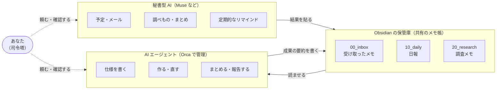
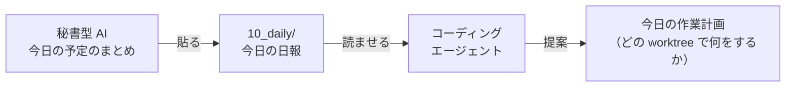
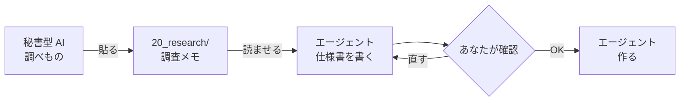

# 上級編: 秘書型 AI（Meta の Muse）と AI エージェントを組み合わせる

> このページは上級編です。基本コースと、[Obsidian](06-obsidian-optional.md)・[複数エージェント](08-multi-agent.md) に慣れてから読むのがおすすめです。

**秘書型 AI** は、予定やメール、調べものなど「身の回りのこと」を代わりにやってくれる AI です。Meta の **Muse**（Meta AI の Muse Spark を使ったエージェント機能）がその例です。

この章では、秘書型 AI と AI コーディングエージェント（Claude Code・Codex・Antigravity・GitHub Copilot など）を組み合わせて、**「予定・情報の整理」から「作る」までを一続きにする**方法を紹介します。

## まず知っておくこと

| 項目 | 内容 |
|---|---|
| Muse でできること（Meta の公式発表より） | メールやカレンダーとの連携、予定をもとにした毎日のブリーフィング（予定の重複や変更の通知）、定期的なタスク（毎週のまとめなど）、調べもの、スライド作成 |
| 使える場所 | Meta AI アプリと meta.ai（WhatsApp にも順次対応と発表） |
| 提供地域・日本語 | 「一部の地域から提供」と発表されています。**日本・日本語で使えるかは要確認**です |
| コーディングエージェントとの連携 | GitHub やコーディングツールと直接つながる機能は、確認できていません。そのため、この章では**ファイル（メモ）を介して受け渡す**方法をとります |
| 料金 | 公式発表には記載がありません。利用前に確認してください |

> 機能や提供地域は変わることがあります。最新情報は [Meta の公式発表](https://about.fb.com/news/2026/07/meta-ai-muse-spark-doesnt-just-think-it-acts/) などで確認してください。Muse が使えない場合も、ほかの秘書型 AI で同じ考え方を使えます。

## 役割分担の考え方

秘書型 AI とコーディングエージェントは、得意なことがはっきり分かれています。**あなたが司令塔**になり、**Obsidian の保管庫を「共有のメモ帳」**にして両者をつなぎます。



| 担当 | 任せること | 任せないこと |
|---|---|---|
| 秘書型 AI | 予定の確認・調整、メールの下書き、調べもの、毎週のまとめ、リマインド | コードの編集、プロジェクトのファイル操作 |
| コーディングエージェント | 仕様書・コード・ドキュメントの作成、テスト、Git の操作 | メールの送信、予定の変更 |
| あなた | 何をやるか決める、結果を確認する、送信・購入などの最終判断 | — |

## 準備

1. [Obsidian の保管庫](06-obsidian-optional.md) を雛形から作り、Orca に登録しておきます
2. 秘書型 AI から受け取ったメモは、保管庫の `00_inbox/` に置きます。雛形の `90_templates/from-secretary.md` を使うと、形がそろって AI が読みやすくなります
3. 秘書型 AI の結果は、コピー＆ペーストで保管庫に貼るのが基本です（直接つながる機能がないため）

## 活用パターン

### 1. 朝のブリーフィング → 今日の作業計画

秘書型 AI のブリーフィングで今日の予定を把握し、**空いている時間に合わせて** AI エージェントの作業を計画します。



**秘書型 AI に：**

```
毎朝、今日の予定と締め切りを、空いている時間帯がわかる形でまとめて
```

**コーディングエージェントに（保管庫で）：**

```
10_daily の今日の日報を読んで、空いている時間に合わせて今日やる作業を3つ提案して。それぞれ、どのプロジェクトのどんな作業か、どれくらいかかりそうかも
```

> 会議などで手が離せない時間に、時間のかかる作業（大きな機能の実装など）をエージェントに任せておくと、待ち時間を有効に使えます。

### 2. 調べものは秘書、作るのはエージェント

秘書型 AI の調べもの（リサーチ）の結果を、そのまま仕様の材料にします。



**コーディングエージェントに：**

```
my-vault の 20_research/〇〇.md を読んで、my-app の docs/spec.md に仕様としてまとめて。わからない点は質問して
```

> 調べた内容は、間違いが含まれることがあります。仕様にする前に、大事な部分は出典（参考URL）を確認しましょう。

### 3. 定期タスクの分担（週報など）

| 曜日・タイミング | 秘書型 AI | コーディングエージェント |
|---|---|---|
| 毎週月曜の朝 | 今週の予定と締め切りをまとめる | — |
| 毎日の終わり | — | 今日の変更内容（コミット）を日報に追記する |
| 毎週金曜 | — | 1週間分の日報から週報を作る（[スキルの例](07-skills.md#skillmd-の書き方)） |
| 週報ができたら | 週報をもとに、共有用のメッセージを下書きする（送信はあなたが確認してから） | — |

### 4. 成果の報告・連絡

エージェントが作ったものを、秘書型 AI に渡して連絡文にします。

**コーディングエージェントに：**

```
今日の変更内容を、プログラミングを知らない人にも伝わるように5行でまとめて
```

**秘書型 AI に（上のまとめを貼って）：**

```
このまとめをもとに、チームへの進捗報告メールを下書きして。送信はしないで
```

## 受け渡しメモの形

秘書型 AI から受け取った内容は、次の形で `00_inbox/` に保存します（雛形の `90_templates/from-secretary.md` と同じです）。

```markdown
---
date: 2026-11-23
tags: [from-secretary]
source: Muse
---

# （タイトル）

## 秘書型 AI に頼んだこと
（頼んだ文をそのまま）

## 受け取った内容
（結果を貼る）

## 次にやること
- [ ] （エージェントに頼むこと・自分で確認すること）
```

- 「頼んだこと」も残しておくと、後からエージェントが文脈を理解しやすくなります
- 「次にやること」は、エージェントに「00_inbox の from-secretary のメモを読んで、次にやることを進めて」と頼むときの手がかりになります

## 安全に使うために

- **送信・購入・予定の変更は、必ず自分で確認してから**。秘書型 AI に「送信はしないで、下書きだけ」と伝える習慣をつけます
- **渡す情報を選ぶ**。秘書型 AI にコードや社外秘の情報、パスワード・API キーを渡さない。コーディングエージェント側にも、メールの中身など必要以上の個人情報を貼らない
- **連携するアプリは必要最小限に**。メール・カレンダーなどの連携は、使うものだけにします
- **仕事で使う場合**は、会社がそのサービスの利用を許可しているか確認します
- **調べた内容をうのみにしない**。大事な判断の前に、出典を確認します

## 補足: Meta の Muse Code について

Meta は、Muse とは別に、ターミナルで動くコーディングエージェント **Muse Code** も出しています。Claude Code などと同じ種類のツールですが、このガイドではまだ動作を確認していません。`AGENTS.md` やスキルを読めるかなどは **要確認** です。
