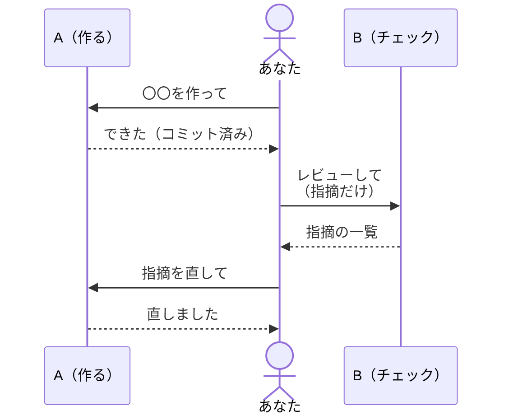
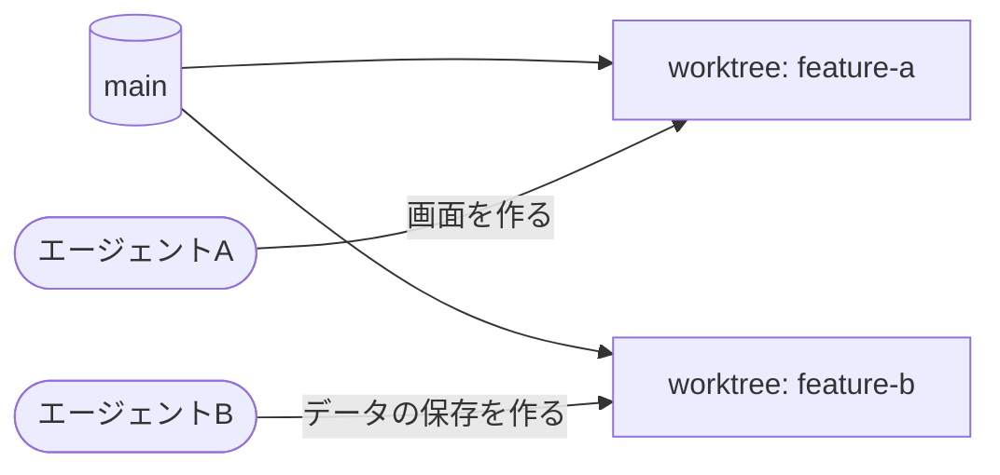
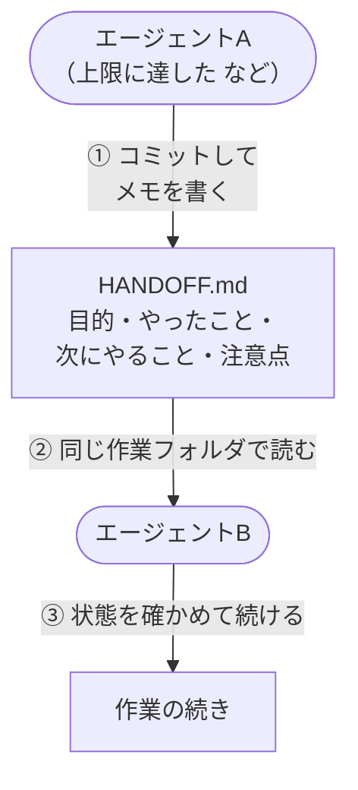

<!-- nav-top -->
[目次](../README.md#読む順番) ＞ ③ 広げる ＞ **09 複数のエージェントを使う**
<!-- /nav-top -->

# 複数のエージェントを契約しているときの Tips

Claude Code・Codex・Antigravity など、複数のエージェントを契約している（使える）場合の活かし方です。1つしか使っていない場合は、読み飛ばして構いません。

## 複数使うと何がうれしいか

| うれしいこと | 内容 |
|---|---|
| 作業が止まらない | 1つが利用枠（使える量の上限）に達しても、別のエージェントで続けられる |
| ミスに気づきやすい | 作った AI とは別の AI がチェックすると、見落としが見つかりやすい |
| 比べて選べる | 同じ相談を2つにして、よい方の案を選べる |
| 並行して進められる | 別々の作業を、別々のエージェントに同時に任せられる |

## まず整えておくこと

どのエージェントに切り替えても、同じように動いてもらうための準備です。このガイドの雛形を使っていれば、1〜2はすでに整っています。

1. **ルールは `AGENTS.md` にまとめる**。`CLAUDE.md` は `@AGENTS.md` の1行だけにする（[06-agents-md.md](06-agents-md.md#エージェントごとに読むファイル)）
2. **スキルは2か所に置く**。`.agents/skills/` と `.claude/skills/`（[08-skills.md](08-skills.md)）
3. **切り替える前にコミットする**。「ここまでをコミットして」と頼んでから別のエージェントに移ると、何か起きても戻せます
4. **各エージェントにログインしておく**。いざ切り替えるときに、ログインで手間取らないようにする

## 使い分けのパターン

### 1. 作る AI とチェックする AI を分ける（いちばんおすすめ）



- チェック役には「直さないで、指摘だけして」と伝えると、作業がぶつかりません
- 指摘を全部うのみにする必要はありません。迷ったら「この指摘は本当に直すべき？理由も教えて」と作った側に聞き返します

### 2. 利用枠のリレー

1つのエージェントが上限に達したら、作業を引き継いで別のエージェントで続けます。引き継ぎ方は下の「[作業を引き継ぐ](#作業を引き継ぐ)」を参照してください。

- 各サービスの上限がリセットされるタイミング（数時間ごと・週ごとなど）を把握しておくと、計画が立てやすくなります
- 重い作業（大きな機能の実装など）は、利用枠に余裕があるエージェントに任せます

### 3. 計画・アイデアの比べ読み（セカンドオピニオン）

大事な決めごと（作るものの構成・使う技術など）は、同じ質問を2つのエージェントにして比べます。

```
〇〇を作りたい。どう作るのがよいか、計画を3案出して。それぞれのよい点・悪い点も
```

- 2つの意見が同じなら、安心して進められます
- 意見が分かれたら、それぞれの理由を比べて**自分で決めます**。片方の案をもう片方に見せて「この案をどう思う？」と聞くのも効果的です

### 4. 並行作業

別々の作業を、別々のエージェントに同時に任せます。[Orca](04-orca.md) で作業ごとに worktree（作業フォルダ）を分ければ、お互いの変更が混ざりません。



> **同じフォルダで、2つのエージェントに同時にファイルを編集させない**でください。変更がぶつかって壊れる原因になります。チェック役のように「読むだけ」なら同じフォルダでも大丈夫です。

### 5. 得意なことで分ける

エージェントやモデルの得意・不得意は、アップデートでよく変わります。決めつけずに、**同じ作業を両方に頼んで比べてみる**のが確実です。比べた結果は `AGENTS.md` やメモに残しておくと、次から迷いません。

## 作業を引き継ぐ

別のエージェントに切り替えるときは、**引き継ぎメモ**を作ってもらいます。このガイドの `handoff` スキルを使うと、決まった形でまとめてくれます。



**引き継ぐ側（今まで作業していたエージェント）に：**

```
別のエージェントに引き継ぐので、引き継ぎメモを作って
```

→ 作業中の内容をコミットし、`HANDOFF.md` に「目的・やったこと・次にやること・注意点」をまとめます。

**受け取る側（新しく使うエージェント）は、引き継ぐ側と同じ作業フォルダで起動します。** `HANDOFF.md` は作業フォルダの中にだけあるメモなので、別の worktree やフォルダで起動すると見つかりません。Orca なら、同じ worktree の中で新しいエージェントを起動します（`orca agent launch --agent <別のID> --worktree name:<作業名>`）。

**受け取る側に：**

```
HANDOFF.md を読んで、作業の続きをして
```

> `HANDOFF.md` は作業フォルダごとの一時的なメモなので、Git には保存しない設定（`.gitignore`）にしています。メモには、作業フォルダの場所（フルパス）も書かれます。
>
> パスワードや API キーなどの秘密情報は、引き継ぎメモにも書かないでください。

利用枠の上限で急に止まった場合でも、受け取る側に「HANDOFF.md がないので、前のエージェントがどこまで進めたか整理して。秘密情報が入っていそうなファイルは開かないで」と頼めば、`handoff` スキルの手順（変更されたファイルの名前を確認 → 必要で安全なファイルだけ中身を確認）で、状況を整理してくれます。

## Orca で複数のエージェントを使う

| やりたいこと | 方法 |
|---|---|
| 作業ごとにエージェントを選ぶ | worktree を作るときにエージェントを選ぶ（CLI では `orca worktree create --name <作業名> --agent <ID>`） |
| 同じ作業フォルダにチェック役を追加 | `orca agent launch --agent <別のID> --worktree name:<作業名>` |
| 入っているエージェントの確認 | `orca agent installed` |
| 同じサービスのアカウントを複数使い分ける | `orca account add --agent claude`（または `codex`）で追加し、`orca account select --agent claude --account <メールアドレスなど>` で切り替え |
| Antigravity のアカウント | Orca の設定の「AI Provider Accounts」から、`agy` でログイン中のアカウントを保存 |
| 過去の会話を探す | `orca search "キーワード"`（エージェントをまたいで会話を検索できる） |

> 同じサービスで複数のアカウントを使う場合は、そのサービスの利用規約で認められているか確認してください。

## 料金と利用枠の管理

- **契約しているプランと上限を一覧にしておく**（サービス名・月額・上限・リセットのタイミング）
- **API キーに注意する**。環境変数などに API キーが設定されていると、月額プランではなく**使った分だけ課金される方式**で動くエージェントがあります（例: Claude Code は `ANTHROPIC_API_KEY` が設定されているとそちらを使います）。意図せず高額にならないよう、各エージェントの状態表示（`/status` など）でどの方式で動いているか確認しましょう
- **使わなくなった契約は見直す**。何か月か使ってみて、出番の少ないものは解約を検討します

## 注意点

- **設定はエージェントごとに別々**です。外部サービスとの連携（MCP）や許可するコマンドの設定は、エージェントごとに行う必要があります
- **秘密情報はどのエージェントにも貼らない**。パスワードや API キーは `.env` に置きます
- **最後に判断するのは自分**です。AI 同士の意見が割れたときや、レビューで指摘が出たときは、理由を聞いたうえで自分で決めます

---

<!-- nav-bottom -->
| ← 前へ: [08 スキルの取り込みと共有](08-skills.md) | [目次](../README.md#読む順番) | 次へ: [10 相談ワークスペース](10-consulting-workspace.md) → |
|:---|:---:|---:|
<!-- /nav-bottom -->
