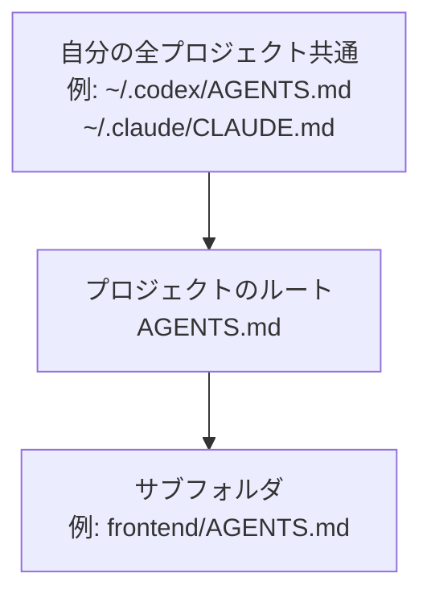
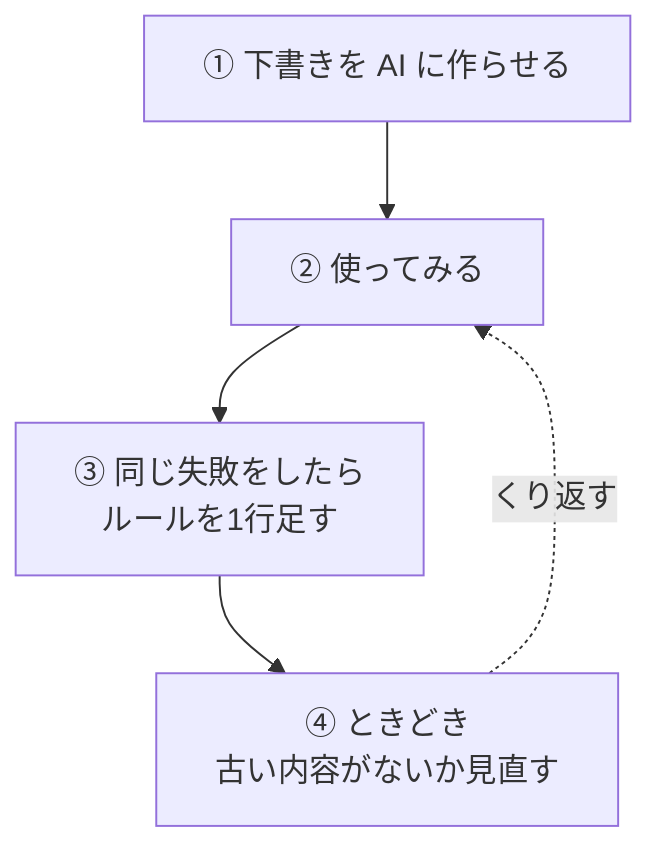

# AGENTS.md の書き方（ベストプラクティスと Tips）

`AGENTS.md` は、AI エージェントが作業を始めるたびに自動で読む**「常設の指示書」**です。ここに何をどう書くかで、AI の仕事ぶりが大きく変わります。

> `AGENTS.md` は、多くのエージェントが読める共通の形式です（[agents.md](https://agents.md/)）。Claude Code 用の `CLAUDE.md` には `@AGENTS.md` の1行だけを書いて、中身を共通にするのがこのガイドのやり方です（[03-tools.md](03-tools.md#指示ファイル最重要)）。

## README.md との違い

| | README.md | AGENTS.md |
|---|---|---|
| 読む人 | 人間 | AI エージェント |
| 書くこと | プロジェクトの紹介、使い方 | AI が作業するための**具体的な指示**（コマンド・ルール・禁止事項） |
| たとえると | パンフレット | 新しく入った人への**引き継ぎ書** |

「初日の新人に、口頭で伝えておきたいこと」を書くイメージです。

## 書くとよいこと（チェックリスト）

- [ ] **概要**: 何のプロジェクトか（1〜3行）
- [ ] **構成**: 主なフォルダと、それぞれの役割
- [ ] **コマンド**: 起動・テスト・チェック（lint）など、そのままコピーして動くもの
- [ ] **ルール**: 書き方の決まり（文体・命名・使うライブラリなど）
- [ ] **完了の条件**: 「テストが通ったら完了」など、どこまでやれば終わりか
- [ ] **やってはいけないこと**: 触ってはいけないファイル、使ってはいけない方法
- [ ] **確認が必要なこと**: ライブラリの追加・ファイルの削除など、先に聞いてほしいこと
- [ ] **Git の運用**: ブランチの切り方、コミットメッセージの形式
- [ ] **用語**: そのプロジェクト特有の言葉の意味

全部埋める必要はありません。最初は「概要・コマンド・ルール」の3つで十分です。

## 書き方のコツ

### 1. 具体的に書く

| ❌ あいまい | ✅ 具体的 |
|---|---|
| きれいなコードを書く | 1つの関数は 30 行以内にする |
| テストをちゃんとする | コミットの前に `npm test` を実行し、すべて通ることを確認する |
| わかりやすい文章で | です・ます調。専門用語には短い説明を添える |

### 2. 理由を一言添える

理由があると、AI が書かれていない場面でも応用できます。

```markdown
- `src/legacy/` は編集しない（古い仕組みで、別のシステムから使われているため）
```

### 3. 「しない」だけでなく「代わりにどうするか」も書く

```markdown
- 新しいライブラリは勝手に追加しない。必要なら理由と候補を挙げて確認する
```

### 4. 箇条書き・短い文で書く

長い文章より、1行1ルールの箇条書きのほうが確実に守られます。

### 5. 大事なことを上に、強調は控えめに

すべてに「重要」「必ず」を付けると、どれが本当に大事かわからなくなります。強調は本当に守ってほしい数個だけにします。

### 6. 長くしすぎない

`AGENTS.md` は毎回読み込まれるので、長いほど AI の「作業用の記憶」を圧迫します。エージェントによっては読む量に上限もあります（例: Codex は初期設定で 32KiB まで）。

- 目安は**1〜2画面（100〜200行程度）**。これを超えそうなら分けます
- 詳しい手順は [スキル](07-skills.md) や `docs/` に書き、`AGENTS.md` からは場所だけ示します（必要なときだけ読ませる）

```markdown
- デプロイの手順は docs/deploy.md を読んでから行う
```

### 7. 実在するものだけを書く

存在しないコマンドや、もう使っていないフォルダが書いてあると、AI はそれを信じて失敗します。構成を変えたら `AGENTS.md` も直します。

### 8. 秘密情報は書かない

`AGENTS.md` は Git で共有されます。パスワードや API キーは書かず、「`.env` の `〇〇` を使う」のように**場所だけ**書きます。

## 置き場所と読まれ方



| 置き場所 | 書くこと | 例 |
|---|---|---|
| 自分の全プロジェクト共通 | 自分の好み | 「日本語で答えて」「結論から短く」 |
| プロジェクトのルート | プロジェクト全体のルール | コマンド・構成・Git の運用 |
| サブフォルダ（必要なときだけ） | その部分だけのルール | `frontend/` だけの書き方の決まり |

- Codex や Antigravity は、作業しているフォルダから上の階層へたどって `AGENTS.md` を読みます。サブフォルダに置いた `AGENTS.md` は、その中で作業するときに効きます
- Claude Code は、サブフォルダの `CLAUDE.md` を、そのフォルダのファイルを扱うときに読みます
- まずはルートの1つだけで十分です。大きくなってきたら分けます

## 育て方

`AGENTS.md` は、最初から完璧に書くものではなく、**使いながら育てる**ものです。



### ① 下書きを AI に作らせる

Claude Code と Codex には、プロジェクトを調べて下書きを作る `/init` コマンドがあります。どのエージェントでも、次のように頼めば作ってくれます。

```
このプロジェクトを調べて、AGENTS.md の下書きを作って。コマンドは実際に動くものだけ書いて
```

### ③ 同じ失敗を2回したら、1行足す

```
さっきの失敗をくり返さないように、AGENTS.md に1行ルールを足して
```

### ④ ときどき見直す

```
AGENTS.md の内容と、今のフォルダ構成やコマンドが食い違っていないか確認して
```

```
AGENTS.md を読んで、あいまいな書き方・矛盾・長すぎる部分を指摘して
```

### 効いているか確かめる

新しい会話を始めて、次のように聞きます。ルールが正しく伝わっているか確認できます。

```
AGENTS.md に書いてあるルールを、3行で要約して
```

## よくある失敗

| 失敗 | どうなるか | 対処 |
|---|---|---|
| 長すぎる | 大事なルールが埋もれて守られない | 詳しい手順はスキルや `docs/` に分ける |
| あいまい | AI が自己流で解釈する | 数字・コマンド・ファイル名で具体的に書く |
| 古いまま | 存在しないコマンドを実行して失敗する | 構成を変えたら一緒に直す |
| ルール同士が矛盾 | AI がどちらに従うか迷う | 見直しを AI に頼む |
| README の丸写し | 作業に必要な情報が足りない | 「AI が作業するときに必要なこと」に絞る |
| 秘密情報が入っている | Git で共有されて漏れる | 場所だけ書き、中身は `.env` に置く |

## 例

このガイドの雛形 [`templates/new-project/AGENTS.md`](../templates/new-project/AGENTS.md) が、そのまま使える例です。

```markdown
# AGENTS.md

## プロジェクト概要
- 家計簿を記録できる Web アプリ（Next.js + TypeScript）

## コマンド
- 開発サーバー: `npm run dev`
- テスト: `npm test`
- チェック: `npm run lint`

## ルール
- 回答とコミットメッセージは日本語
- 完了の条件: `npm test` と `npm run lint` がすべて通ること
- 新しいライブラリは追加する前に、理由と候補を挙げて確認する
- `.env` の中身は読まない・表示しない

## Git
- 作業は `feature/〜` のブランチ（Orca では worktree）で行う
- 1つの変更ごとに小さくコミットする
```

もっと大きな例として、このリポジトリのルートにある [`AGENTS.md`](../AGENTS.md) も参考になります（ガイド役としてのふるまいと、編集するときのルールを分けて書いています）。
