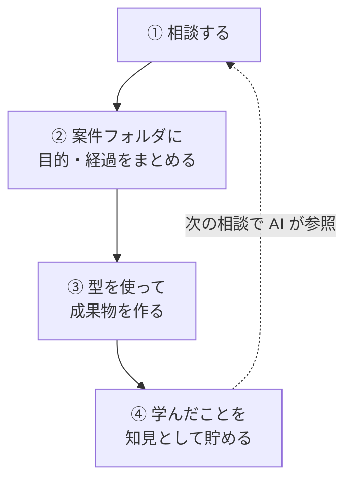
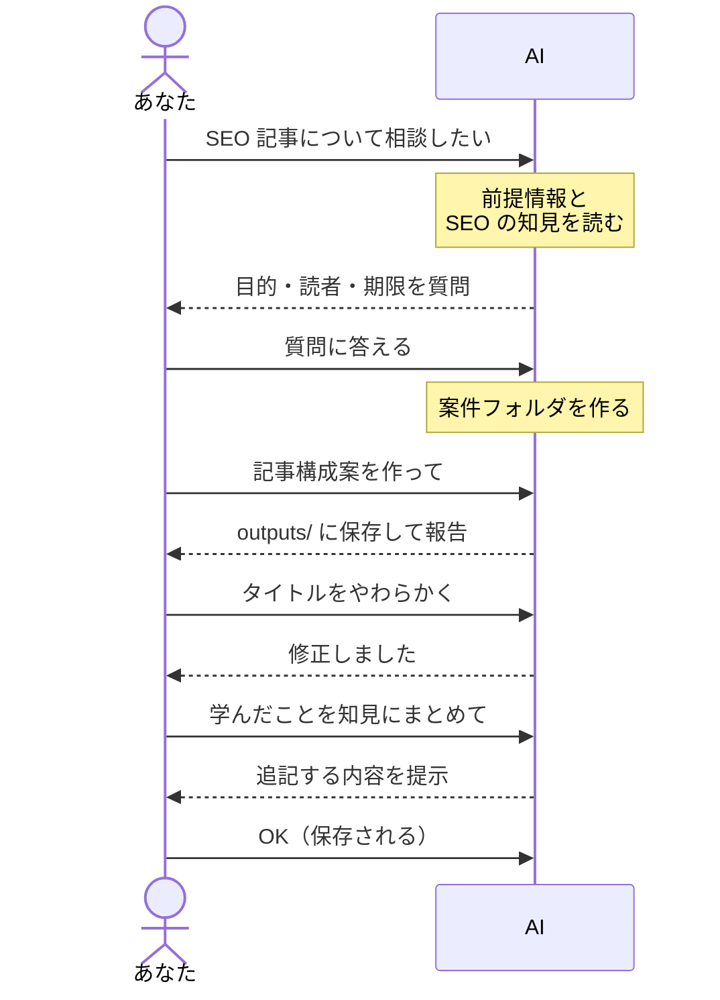

<!-- nav-top -->
[目次](../README.md#読む順番) ＞ ③ 広げる ＞ **10 相談ワークスペース**
<!-- /nav-top -->

# 相談ワークスペース（開発以外の仕事に使う）

AI エージェントは、アプリづくりだけでなく、**SEO・ブランディング・企画・文章・デザインの準備**など、いろいろな相談に使えます。このページでは、相談を重ねるほど**知見が貯まり、成果物の質が上がっていく**仕組みの雛形 `consulting-workspace` を紹介します。

## 仕組み



1つの案件が終わるたびに知見（`20_knowledge/`）が増えていき、次の相談のときに AI がそれを読んでから答えます。**使うほど、自分専用の相談相手に育っていく**イメージです。

## フォルダの構成

```
my-workspace/
├── 00_inbox/            # 相談したいこと・資料・メモをとりあえず置く
├── 10_context/          # 毎回 AI が読む前提情報
│   ├── profile.md       #   自分・会社・お客さんのこと
│   └── brand.md         #   文章のトーン、使わない言葉、色など
├── 20_knowledge/        # 相談で得た知見（seo/ branding/ design/ … とテーマ別に増えていく）
├── 30_projects/         # 案件ごとのフォルダ
│   └── 2026-11-23-1430-サイト改善/   # 案件 ID（作成した日時）＋テーマ
│       ├── brief.md     #   依頼主・依頼内容・目的・ゴール・資料の一覧
│       ├── notes.md     #   相談の経過・決めたこと
│       ├── materials/   #   受け取った資料
│       └── outputs/     #   成果物
├── 90_templates/        # 成果物の型
├── AGENTS.md            # AI への進め方のルール
└── README.md            # 使い方
```

## 入っている成果物の型

| 型 | 用途 |
|---|---|
| 企画書（`proposal.md`） | 背景・目的・提案・スケジュール・リスクをまとめる |
| 記事構成案（`article-outline.md`） | SEO 記事などの、キーワード・タイトル案・見出し構成 |
| SEO レポート（`seo-report.md`） | サイトの現状・課題・改善案の優先順位 |
| ブランドガイド（`brand-guide.md`） | ブランドの核・言葉づかい・見た目のルール |
| デザイン依頼書（`design-brief.md`） | デザイナーやデザインツールに渡す依頼内容 |
| 画像生成の指示文（`image-prompt.md`） | 画像生成 AI に渡す指示文（日本語と英語） |

型が足りなければ、「〇〇の型を 90_templates に追加して」と頼めば増やせます。

> **画像について**: AI コーディングエージェントは、写真やイラストそのものを描くのは得意ではありません（図やアイコンなら SVG で作れます）。画像が必要なときは、エージェントに**画像生成 AI 向けの指示文**を作ってもらい、それを画像生成のツールに渡します。

## はじめ方

### 1. 雛形から作る

Orca で `ai-dev-setup` を開き、エージェントに頼みます。

```
templates の consulting-workspace を使って、my-workspace という名前で相談ワークスペースを作って
```

自分でコピーする場合は、[05-directory-and-tips.md](05-directory-and-tips.md#テンプレートから新しいプロジェクトを作る) の `new-project` を `consulting-workspace` に読み替えてください。

### 2. 前提情報を埋める

作った `my-workspace` を Orca に登録し、エージェントを起動して頼みます。

```
10_context の profile.md と brand.md を、質問しながら一緒に埋めて
```

ここを埋めておくと、どの成果物も自分（自社）らしいトーンでそろいます。

### 3. 相談する

あとは相談するだけです。AI は `AGENTS.md` とスキルの手順に沿って、案件フォルダを作り、経過を記録しながら進めます。

## 使い方の例（SEO 記事を作る）



| やりたいこと | 頼み方の例 |
|---|---|
| 相談を始める | 「〇〇について相談したい」 |
| 成果物を作る | 「この案件の企画書を作って」「記事構成案にまとめて」 |
| 知見を貯める | 「この案件で学んだことを知見にまとめて」 |
| 過去の知見を使う | 「SEO について、これまでに貯めた知見を教えて」 |
| 型を増やす | 「SNS 投稿案の型を 90_templates に追加して」 |

## 入っているスキル

| スキル | できること |
|---|---|
| `consult` | 前提情報と過去の知見を読んでから、相談内容を整理し、案件フォルダを作る |
| `make-deliverable` | 型を使って成果物を作り、`outputs/` に保存する |
| `harvest-knowledge` | 案件の経過から、次にも使える知見を抜き出して `20_knowledge/` に貯める（保存前に確認あり） |
| `handoff` | 別のエージェントに作業を引き継ぐ（[09-multi-agent.md](09-multi-agent.md#作業を引き継ぐ)） |

## Obsidian との関係

中身はすべて Markdown なので、Obsidian の「フォルダを保管庫として開く」で開けば、メモアプリとしても使えます。

| 雛形 | 向いている使い方 |
|---|---|
| `obsidian-vault` | 日報・調べもの・アイデアなど、**個人のメモ** |
| `consulting-workspace` | 相談から**成果物を作る仕事**と、その知見 |

両方を並べて使っても構いません。

## 注意点

- **お客さんの情報を扱う場合**、GitHub に置くなら必ず**非公開（Private）リポジトリ**にします
- 知見（`20_knowledge/`）には、お客さんの名前・個人情報・社外秘の数字を書きません。`harvest-knowledge` スキルは一般的な形に書き直し、出典も案件 ID（例: `2026-11-23-1430`）だけにして、保存前に最終版を見せてくれます
- そのため、**案件フォルダの名前にもお客さんの名前を入れません**（例: `2026-11-23-1430-サイト改善`）。お客さんの情報は、案件フォルダの `brief.md` の中にだけ書きます
- AI の調べた内容や数字には間違いが含まれることがあります。成果物を外に出す前に、出典を確認しましょう

---

<!-- nav-bottom -->
| ← 前へ: [09 複数のエージェントを使う](09-multi-agent.md) | [目次](../README.md#読む順番) | 次へ: [11 Obsidian（任意）](11-obsidian-optional.md) → |
|:---|:---:|---:|
<!-- /nav-bottom -->
