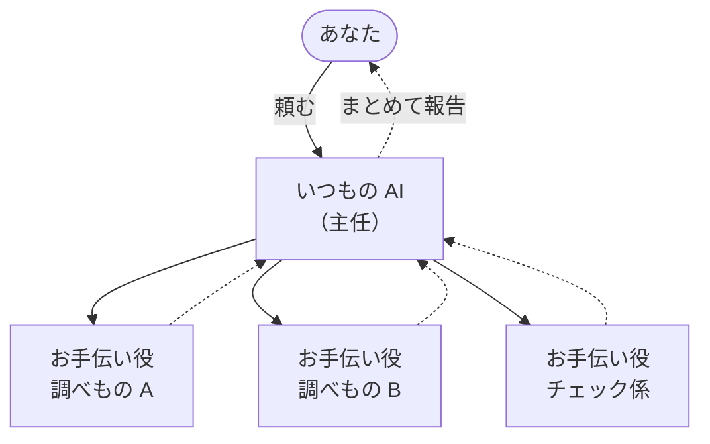

<!-- nav-top -->
[目次](../README.md#読む順番) ＞ ④ 広げる ＞ **13 サブエージェントの使い方**
<!-- /nav-top -->

# サブエージェントの使い方

**サブエージェント**は、AI エージェントが仕事の一部を任せる**「お手伝い役の AI」**です。主任（いつも話している AI）が、手伝いの人に「これを調べてきて」と頼み、結果だけを受け取るイメージです。

> [複数のエージェントを使う](12-multi-agent.md) は「Claude Code と Codex のように、**別の AI を使い分ける**」話です。サブエージェントは「**1つの AI の中で**、手伝い役に分担させる」話です。

## しくみ



実線の矢印が「任せる」、点線の矢印が「結果だけを報告する」です。お手伝い役は、**別の机（別の会話）**で作業して、結果だけを主任に渡します。そのため、次のよいことがあります。

| よいこと | 説明 |
|---|---|
| いつもの会話が散らからない | 調べものの途中経過は、お手伝い役の机に残るだけ。主任の会話は軽いまま |
| 同時に進められる | 「A 社と B 社と C 社を調べて」を、3人に分けて同時に進められる |
| 別の目で見てもらえる | 作った本人とは別のお手伝い役にチェックさせると、見落としに気づきやすい |

## 使うとよい場面・使わなくてよい場面

| 使うとよい | 使わなくてよい |
|---|---|
| いくつものことを、別々に調べるとき | 小さな仕事（1つの文章を直す など） |
| 長い資料を読ませて、要点だけほしいとき | 順番に1つずつ進める仕事 |
| できたものを、別の目でチェックしたいとき | 同じファイルを何人もで書き換える仕事 |

> お手伝い役も、それぞれ AI の**利用枠（使える量）を使います**。何でもサブエージェントにすると、上限に早く達します。「たくさん調べる」「別の目で見る」ときに絞って使うのがおすすめです。

## 頼み方（どのエージェントでも共通）

いちばん簡単なのは、ふだんの言葉で「サブエージェントを使って」と頼むことです。AI が自分で手伝い役を呼びます。

```
サブエージェントを使って、〇〇・△△・□□の3つを並行して調べて。最後に比べやすい表にまとめて
```

```
この資料（inbox の〇〇）を、サブエージェントに読ませて、要点だけ5行で教えて
```

```
できた企画書を、サブエージェントにチェックさせて。直さずに、気になる点だけ挙げて
```

> 「チェック役」には**直させずに指摘だけ**してもらうと、作ったものが勝手に書き換わらず安心です。

## AI 仕事部屋での使いどころ

| やりたいこと | 頼み方の例 |
|---|---|
| 調べものを広く集める | 「サブエージェントを使って、近くのパン屋さん5軒の特徴を並行して調べて、表にまとめて」 |
| 記事を別の目で見る | 「書いたブログ記事を、読者の立場のサブエージェントに読ませて、わかりにくいところを挙げて」 |
| 案を比べる | 「キャッチコピーを、3人のサブエージェントにそれぞれ5案ずつ考えさせて。重なりのないように」 |
| 過去の記録を探す | 「サブエージェントに knowhow と work を探させて、SNS について役に立つことを集めて」 |

## ステップアップ: 専属のお手伝い役を作る

よく使う役割（校正係・調べもの係 など）は、**専属のお手伝い役**として登録しておけます。登録しておくと、名前で呼んだり、AI が必要なときに自分で呼んだりできます。

いちばん簡単なのは、AI に作ってもらうことです。

```
文章の誤字や言い回しをチェックする「校正係」のサブエージェントを作って。直さずに指摘だけするようにして
```

登録する場所と形は、エージェントによって違います。

| エージェント | 置き場所（このプロジェクト用） | 形 | 公式の説明 |
|---|---|---|---|
| Claude Code | `.claude/agents/<名前>.md` | Markdown | [サブエージェント](https://code.claude.com/docs/en/sub-agents) |
| Codex | `.codex/agents/<名前>.toml` | TOML（設定ファイル） | [Subagents](https://developers.openai.com/codex/subagents) |
| Antigravity | 公式の説明を参照 | — | [Custom subagents](https://antigravity.google/docs/subagents) |
| GitHub Copilot CLI | `.github/agents/<名前>.agent.md` | Markdown | [カスタムエージェント](https://docs.github.com/ja/copilot/how-tos/copilot-cli/customize-copilot/create-custom-agents-for-cli) |

例: Claude Code の校正係（`.claude/agents/proofreader.md`）

```markdown
---
name: proofreader
description: 文章の誤字・言い回し・事実のまちがいをチェックする校正係。文章ができたあとの確認に使う。
---

あなたは校正係です。渡された文章を読み、次の点をチェックしてください。

- 誤字・脱字
- わかりにくい言い回し
- 日付・値段・名前などの事実のまちがい（確認できないものは「要確認」）
- about/brand.md の雰囲気に合っているか

文章は書き換えず、気になる点を「どこを・なぜ・どう直すとよいか」の形で、重要な順に挙げてください。
```

- `description` には「何をするか」と「どんなときに使うか」を書きます。AI はこれを見て、いつ呼ぶかを判断します
- 新しく登録したお手伝い役は、エージェントを起動し直すと使えるようになるものが多いです
- 形はエージェントごとに違うので、複数のエージェントを使う場合は、それぞれに作るよう AI に頼みます

> Codex は、設定によってはサブエージェントの機能を有効にする必要があります（要確認）。使えない場合は「サブエージェントを使えるようにして」と頼むか、[公式の説明](https://developers.openai.com/codex/subagents)を確認してください。

## 気をつけること

- **利用枠を多く使う**: お手伝い役の数だけ、AI の使える量を使います
- **同じファイルを同時に書き換えさせない**: 調べもの・読むだけ・チェックだけの役割にするのが安全です
- **結果は自分でも確認する**: お手伝い役の報告もまちがえることがあります。大事なところは出典を確認します

---

<!-- nav-bottom -->
| ← 前へ: [12 複数のエージェントを使う](12-multi-agent.md) | [目次](../README.md#読む順番) | 次へ: [14 Obsidian（任意）](14-obsidian-optional.md) → |
|:---|:---:|---:|
<!-- /nav-bottom -->
